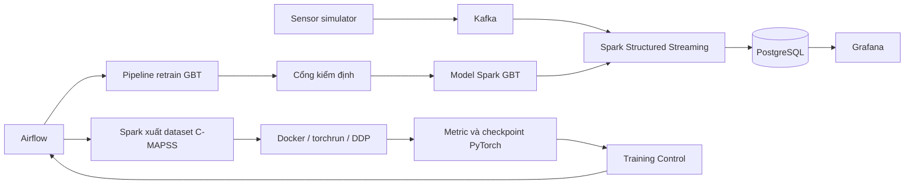

# Nền tảng bảo trì dự đoán cho IoT công nghiệp

Hệ thống mô phỏng dữ liệu cảm biến động cơ, xử lý luồng và dự đoán thời gian sử dụng còn lại (**RUL**) cùng nguy cơ hỏng trong **60 chu kỳ** tiếp theo. Dữ liệu nền là NASA C-MAPSS.

Pipeline đang phục vụ dùng **Spark MLlib GBT**. Bên cạnh đó, **Training Control** cho phép chạy ứng viên **PyTorch DDP** theo lịch Airflow hoặc từ giao diện, theo dõi từng rank, metric, log và checkpoint.

## Kiến trúc



| Thành phần | Vai trò |
|---|---|
| Sensor — FastAPI, React | Sinh/phát lại cảm biến, cấu hình đội máy và lỗi chèn |
| Kafka | Nhận và phân phối bản tin cảm biến |
| Spark | Làm sạch, chuẩn hóa, tạo cửa sổ và dự đoán trên luồng |
| PostgreSQL, Grafana | Lưu kết quả và quan sát tình trạng đội máy |
| Airflow | Điều phối huấn luyện lại, kiểm định và các lượt DDP |
| Training Control | Cấu hình lịch, chạy/dừng và theo dõi workload PyTorch |

## Yêu cầu

- Docker Engine/Compose; Windows có thể dùng Docker Desktop với WSL2.
- Cấp khoảng **10–12 GB RAM cho Docker** khi chạy cả stack Spark/Airflow.
- Chuẩn bị dữ liệu trong `data/raw/cmapss/`. Bốn file bắt buộc: `train_FD001.txt`, `train_FD002.txt`, `train_FD003.txt`, `train_FD004.txt`. Có thể đặt thêm các file test/RUL của bộ dữ liệu để đánh giá ngoại tuyến.
- CPU đủ để chạy demo DDP. Chế độ CUDA cần GPU NVIDIA và khả năng cấp GPU cho container.

Dataset, model đã train, token và state cục bộ không nằm trong phần mã nguồn cần commit.

## Khởi chạy nhanh

Các lệnh dưới đây dùng PowerShell, bắt đầu từ thư mục gốc workspace:

```powershell
powershell -ExecutionPolicy Bypass -File .\training\Start-Training.ps1
```

Launcher build các image cần thiết, tạo `.env.training`, chuẩn bị bản dữ liệu làm việc, khởi động Kafka/Postgres/Spark/Airflow, sensor và Training Control. Lần đầu cần tải image và dependencies.

Để chạy thêm job dự đoán trực tuyến và các dashboard:

```powershell
docker compose --env-file .env.training up -d spark grafana kafka-ui
```

Mở sensor rồi bấm **Chạy** để bắt đầu phát dữ liệu. Service `init` dùng lại model hiện có; nếu chưa có, nó chuẩn bị nhóm dữ liệu và train phiên bản Spark đầu tiên.

Các lần sau, từ cùng thư mục:

```powershell
docker compose --env-file .env.training up -d
docker compose --env-file .env.training logs --tail 60 airflow training-control sensor
```

## Giao diện

| Địa chỉ | Nội dung |
|---|---|
| <http://localhost:8000/> | Sensor simulator |
| <http://localhost:8001/> | Training Control: cấu hình, lịch sử, rank, metric và log |
| <http://localhost:8088/> | Airflow: `retrain_rul` và `single_node_rul_training` |
| <http://localhost:8080/> | Spark master |
| <http://localhost:8081/>, <http://localhost:8082/> | Hai Spark worker |
| <http://localhost:3000/d/pdm> | Grafana, sau khi khởi động service |
| <http://localhost:8085/> | Kafka UI, sau khi khởi động service |
| <http://localhost:4040/> | Spark UI của job streaming, khi job chạy |
| <http://localhost:4041/> | Spark UI của job chuẩn bị/train, khi job chạy |
| `localhost:5432` | PostgreSQL |
| `localhost:9094` | Kafka cho client trên host |

Các cổng web bind `127.0.0.1`. Cấu hình truy cập đơn giản hiện tại dành cho môi trường phát triển cục bộ; Docker socket được cấp cho thành phần điều phối.

Grafana dùng tài khoản `admin`, mật khẩu từ `GRAFANA_PASSWORD` (mặc định `admin`). PostgreSQL dùng database/user `pdm`, mật khẩu từ `POSTGRES_PASSWORD` (mặc định `pdm`). Có thể đặt các biến môi trường này trước khi chạy launcher.

## Hai đường huấn luyện

### Spark GBT — model phục vụ

DAG `retrain_rul` thực hiện:

```text
build_training_set → train → validate → gate → promote / keep_current
```

Model ứng viên chỉ thay con trỏ `models/current.json` khi qua cổng kiểm định. Job streaming tiếp tục dùng Spark PipelineModel.

### PyTorch DDP — ứng viên độc lập

Từ Training Control:

1. Chọn CPU/Gloo hoặc CUDA/NCCL, số rank, epoch, batch size, learning rate và tỷ lệ máy train.
2. Lưu cấu hình rồi bấm **Chạy ngay qua Airflow**.
3. Quan sát tiến độ từng rank, loss, RUL RMSE, F1, log và checkpoint; dùng nút dừng khi cần.
4. Có thể bật lịch mỗi 5 phút, mỗi giờ hoặc 02:00 giờ Việt Nam. Mặc định cài mới, lịch tự động tắt.

Mỗi lượt hiện dùng **một container trên một máy**, chứa nhiều process/rank. Mỗi rank giữ bản sao model, xử lý phần dữ liệu do sampler chọn và đồng bộ gradient với các rank khác. `batch_size` là batch **mỗi rank**; hai rank với batch 64 có global batch 128 ở bước đầy.

Model MLP dùng 33 đặc trưng C-MAPSS và hai đầu ra RUL/sắp hỏng. Checkpoint PyTorch chưa tự thay model GBT trong pipeline phục vụ. Hiện toàn Training Control chỉ cho một lượt queued/starting/running cùng lúc.

Đã kiểm chứng local: CPU hai rank hoàn tất 12 epoch và CUDA một rank. Chưa có benchmark công bằng chứng minh tăng tốc một rank so với hai rank. [Tài liệu DDP](docs/huong-dan-train-ddp.md) giải thích chi tiết và cách so sánh.

## Dữ liệu và lưu trạng thái

- `data/raw/cmapss/`: dữ liệu nguồn, giữ nguyên khi chuẩn bị runtime.
- `.local/cmapss/`: bản làm việc đã kiểm tra; sửa định dạng số được ghi vào manifest.
- `models/`: model Spark và thống kê/nhóm dữ liệu.
- `data/training/`: cache NPZ, checksum và log chuẩn bị cho DDP.
- Volume `training-state`: SQLite lưu cấu hình và lịch sử Training Control.
- Volume `pdm_training_artifacts`: checkpoint và `result.json` của các lượt PyTorch.
- `.env.training`: token gọi API nội bộ; launcher tạo tự động và Git bỏ qua file này.

Dataset DDP hiện lấy raw C-MAPSS theo nhóm train/validation cố định, tách nhóm replay. Nó chưa tự lấy tập dữ liệu mới mà pipeline GBT dựng từ các máy đã hỏng.

## Kiểm thử và phát triển

Từ thư mục chứa `docker-compose.yml`, chuẩn bị môi trường dev:

```powershell
py -3.12 -m venv .venv
.\.venv\Scripts\python.exe -m pip install -r sensor/backend/requirements-dev.txt -r training/requirements.txt
.\.venv\Scripts\python.exe -m pytest training/tests -q
```

Test sensor với bản dữ liệu làm việc do launcher tạo:

```powershell
$env:CMAPSS_DATA_DIR = './.local/cmapss'
$env:PYTHONPATH = (Resolve-Path './sensor/backend').Path
.\.venv\Scripts\python.exe -m pytest sensor/backend/tests -q
```

Test Spark trong môi trường container:

```powershell
docker compose --env-file .env.training exec -e SPARK_MASTER=local[2] airflow python -m pytest tests/test_dag.py tests/test_pdm.py tests/test_windows.py -q
```

Kiểm tra build frontend độc lập:

```powershell
Push-Location training/frontend
npm ci
npm run build
Pop-Location
```

Khi phát triển, Training Control frontend dùng cổng 5174 và proxy API tới backend 8001. Các kiểm thử đã đạt trong workspace: 32 test training, 76 test sensor và 23 test Spark được chọn; không phải kết quả benchmark hiệu năng.

## Dừng và chạy lại

```powershell
docker compose --env-file .env.training stop
docker compose --env-file .env.training up -d
```

`stop` giữ container và state. `down` giữ named volume; thêm `-v` sẽ xóa named volume, nên chỉ dùng khi chủ động muốn bỏ trạng thái đó.

## Tài liệu và mã nguồn

| Tài liệu / thư mục | Nội dung |
|---|---|
| [Hướng dẫn DDP](docs/huong-dan-train-ddp.md) | Cơ chế gradient, rank, sampler, batch và so sánh tập trung |
| [Vận hành Training Control](training/README.md) | Launcher, lifecycle, state và giới hạn hiện tại |
| [Ba phương án triển khai](docs/airflow-distributed-training-deployment.md) | Một máy nhiều GPU, Kubernetes và Slurm; phân biệt phần đã chạy và thiết kế |
| [Số đo Spark](docs/do-dac.md) | Báo cáo đo của pipeline Spark |
| `sensor/` | Backend và frontend sensor |
| `spark/` | Job streaming, feature/label, DAG và cấu hình hạ tầng |
| `training/` | Workload DDP, Docker runner, API/UI Training Control và test |
