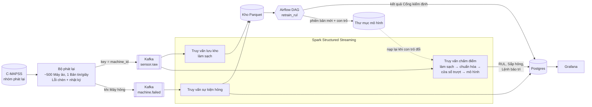

# Kiến trúc hệ thống: Nền tảng bảo trì dự đoán cho IoT công nghiệp

Đề tài 9 trong `De tai chi tiet.pdf`. Tài liệu này mô tả hệ thống sẽ xây, lý do của từng lựa chọn, và những điểm chưa kiểm chứng. Thuật ngữ in đậm lần đầu (Máy, Bản tin, Chu kỳ, RUL...) được định nghĩa ở Mục 15. Kế hoạch triển khai nằm trong [`plan.md`](plan.md).

Trạng thái: **phần mô hình ngoại tuyến (Mục 6.2, 7 và Cổng kiểm định) và đường chấm điểm tối thiểu (Bộ phát lại → Kafka → job luồng trên cụm Spark → Postgres → Grafana) đã chạy trên dữ liệu thật; Lệnh bảo trì, kho, Lỗi chèn và Airflow còn là thiết kế.** Mục 13 liệt kê những gì còn là giả định.

## 1. Bài toán và phạm vi

Hệ thống nhận liên tục số đo cảm biến từ nhiều động cơ, dự đoán mỗi động cơ còn chạy được bao lâu trước khi hỏng, và tự sinh đề xuất bảo trì trước thời điểm đó. Mô hình dự đoán được huấn luyện lại định kỳ và chỉ được đưa vào dùng nếu tốt hơn mô hình cũ.

| Yêu cầu trong đề | Cách hệ thống đáp ứng |
|---|---|
| Kafka nhận dữ liệu cảm biến ≥ 500 events/giây | Bộ phát lại giữ khoảng 500 **Máy ảo** hoạt động cùng lúc, mỗi máy một **Bản tin** mỗi giây |
| Spark Streaming làm sạch dữ liệu | Lọc giá trị ngoài miền, khử trùng lặp, xử lý Bản tin đến trễ bằng watermark |
| Trích đặc trưng cửa sổ trượt (rolling mean, rolling std) | Cửa sổ trượt 30 giây, bước 5 giây, theo từng Máy |
| Gradient-Boosted Trees / Random Forest trên Spark MLlib ước lượng RUL | GBT hồi quy **RUL** và GBT phân lớp **Sắp hỏng**, dùng chung đặc trưng |
| Lên lịch bảo trì tự động | **Lệnh bảo trì** sinh tự động khi một Máy Sắp hỏng |
| Airflow điều phối huấn luyện lại và kiểm định định kỳ | Một DAG: huấn luyện lại → **Cổng kiểm định** → thay **Mô hình đang dùng** |

Ngoài phạm vi (cố ý không làm):

- Thiết bị cảm biến thật. Luồng IoT là giả lập.
- Tối ưu lịch bảo trì có ràng buộc (số đội thợ, chi phí dừng máy).
- Cụm trên nhiều máy vật lý, HDFS, bảo mật, chịu lỗi của broker. Hệ thống chạy trên một laptop; cụm Spark gồm nhiều container trên laptop đó (Mục 12).
- Random Forest và so sánh nhiều mô hình. Chỉ làm nếu còn thời gian.

## 2. Dữ liệu nguồn: NASA C-MAPSS

Các số dưới đây đo trực tiếp trên file đã tải về `data/raw/cmapss/` ngày 10/10/2026.

| Tập | Máy train / test | Bản tin train | Bản tin test | Vòng đời train (Chu kỳ) | Điều kiện vận hành | Kiểu hỏng |
|---|---|---|---|---|---|---|
| FD001 | 100 / 100 | 20.631 | 13.096 | 128–362 | 1 | 1 |
| FD002 | 260 / 259 | 53.759 | 33.991 | 128–378 | 6 | 1 |
| FD003 | 100 / 100 | 24.720 | 16.596 | 145–525 | 1 | 2 |
| FD004 | 249 / 248 | 61.249 | 41.214 | 128–543 | 6 | 2 |
| Tổng | 709 / 707 | 160.359 | 104.897 | trung bình khoảng 226 | | |

Những đặc điểm quyết định thiết kế:

- **Cấu trúc.** Mỗi dòng là một Bản tin gồm 26 cột cách nhau bằng dấu cách: số máy, Chu kỳ, 3 thiết lập vận hành, 21 cảm biến. Không có dòng tiêu đề, không có timestamp.
- **Nhãn.** Máy trong tập train chạy tới lúc hỏng, nên RUL của một Bản tin = Chu kỳ cuối của máy − Chu kỳ hiện tại. Máy trong tập test dừng trước khi hỏng; RUL thật tại Bản tin cuối nằm trong file `RUL_FD00x.txt`.
- **Sáu Điều kiện vận hành.** Làm tròn ba cột thiết lập cho ra đúng 6 tổ hợp, giống nhau ở tập train và test. Một Máy trong FD002/FD004 nhảy qua lại cả sáu điều kiện giữa các Chu kỳ. FD001/FD003 chỉ có một điều kiện, trùng với một trong sáu điều kiện kia.
- **Chênh lệch giữa các điều kiện lấn át tín hiệu xuống cấp.** Cảm biến 2 có trung bình từ 537 đến 643 tùy điều kiện, trong khi trong một điều kiện nó chỉ dao động vài đơn vị suốt vòng đời. Vì vậy phải chuẩn hóa theo điều kiện trước khi tính bất cứ đặc trưng nào (Mục 6.2).
- **16 cảm biến mang thông tin.** Các cảm biến 2, 3, 4, 6, 7, 8, 9, 10, 11, 12, 13, 14, 15, 17, 20, 21 biến thiên trong cả sáu điều kiện. Năm cảm biến 1, 5, 16, 18, 19 là hằng số trong hầu hết hoặc tất cả điều kiện và bị loại.
- **Dữ liệu sạch.** Không có giá trị thiếu, không trùng lặp, không trễ. Mọi lỗi để phần làm sạch xử lý đều phải do bộ phát lại chèn vào.
- **Số máy trùng nhau giữa các tập.** Tập nào cũng đánh số từ 1, nên định danh một vòng đời nguồn là cặp (tập, số máy).
- **Quá nhỏ so với tải yêu cầu.** Ở 500 events/giây, toàn bộ tập train phát hết trong khoảng 5 phút. Phải nhân bản thành Máy ảo.
- **Không có cảm biến độ rung.** Đề nhắc "nhiệt độ, áp suất, độ rung"; C-MAPSS có nhiệt độ, áp suất và tốc độ quay (theo bài báo gốc, chưa đối chiếu lại từng cột). Cần nói rõ điều này trong báo cáo.
- **Giấy phép.** NASA không ghi giấy phép chính thức, chỉ yêu cầu trích Saxena, Goebel, Simon, Eklund (2008), PHM08.

File README của NASA có hai chỗ sai so với dữ liệu: ghi 26 cảm biến (thực tế 21) và đảo số máy train/test của FD004.

## 3. Tổng quan kiến trúc



Hệ thống có hai đường dữ liệu:

- **Đường nóng** (giây): Bản tin → Kafka → Spark → dự đoán và Lệnh bảo trì trong Postgres → Grafana. Đường này chạy liên tục.
- **Đường lạnh** (giờ/ngày): Bản tin đã lưu trong kho Parquet → Airflow huấn luyện lại → mô hình mới quay về đường nóng. Đường này chạy theo lịch.

Điểm nối hai đường là **thư mục mô hình** và **sự kiện Máy hỏng**. Sự kiện hỏng là thứ duy nhất cho biết RUL thật của dữ liệu mới: trước khi Máy hỏng, không ai biết nó còn bao nhiêu Chu kỳ.

## 4. Bộ phát lại (giả lập luồng IoT)

Một chương trình Python chạy trong container, đóng vai toàn bộ nhà máy.

**Chia dữ liệu trước khi phát.** Các Máy trong tập train của cả bốn tập con được chia theo máy (không chia theo dòng):

| Nhóm | Tỷ lệ | Dùng để |
|---|---|---|
| Nhóm huấn luyện gốc | 70% số Máy train (khoảng 496) | Huấn luyện mô hình đầu tiên, tính bảng thống kê chuẩn hóa |
| Nhóm kiểm định | 10% số Máy train (khoảng 71) | Tập đo của Cổng kiểm định; không bao giờ đưa vào huấn luyện |
| Nhóm phát lại | 20% số Máy train (khoảng 142) | Nguồn vòng đời cho bộ phát lại |
| Tập test chính thức | 707 Máy + file RUL | Chỉ đo để báo cáo; không dùng để huấn luyện hay để chọn mô hình |

Cổng kiểm định không dùng tập test chính thức: nếu dùng nó để chọn mô hình thì RMSE báo cáo trên chính tập đó không còn khách quan và không so được với các bài nghiên cứu.

**Phiên bản đầu tiên cố ý học ít.** Mô hình đầu tiên chỉ học 20% nhóm huấn luyện gốc (khoảng 100 Máy; tỷ lệ là tham số), còn bảng thống kê chuẩn hóa vẫn tính từ cả nhóm. Lần huấn luyện lại đầu tiên dùng cả nhóm gốc cộng các Máy ảo đã hỏng, nên vượt Cổng kiểm định một cách chắc chắn thay vì may rủi. Nó mô phỏng một hệ thống khởi động với ít dữ liệu rồi tự tốt lên. Số đo trên tập test chính thức lấy từ một phiên bản học cả nhóm gốc.

Nhóm phát lại lấy từ tập train vì các Máy này chạy tới lúc hỏng, nên kiểm tra được Lệnh bảo trì có ra trước khi hỏng hay không.

**Máy ảo.** Bộ phát lại luôn giữ khoảng 500 Máy ảo đang sống. Mỗi Máy ảo:

- nhận một mã mới (`vm-000001`, `vm-000002`, ...), không lộ nguồn gốc;
- chạy theo vòng đời của một Máy ngẫu nhiên trong nhóm phát lại, cộng thêm nhiễu Gauss nhỏ riêng vào số đo cảm biến để hai bản sao không trùng nhau (ba cột thiết lập giữ nguyên, vì Điều kiện vận hành suy ra từ chúng);
- phát một Bản tin mỗi giây, tức **1 Chu kỳ = 1 giây**, với `event_time` là thời điểm phát. Trong dữ liệu gốc một Chu kỳ là một chuyến bay; hệ thống nén thời gian để một vòng đời diễn ra trong vài phút. Mọi khoảng thời gian tính bằng giây trong tài liệu này vì thế nên đọc là số Chu kỳ;
- khi hết vòng đời thì phát một sự kiện hỏng vào `machine.failed`, và một Máy ảo mới được sinh thay thế.

Lúc khởi động, các Máy ảo bắt đầu ở Chu kỳ ngẫu nhiên trong vòng đời để không hỏng đồng loạt.

Hệ quả cần biết: với vòng đời trung bình khoảng 226 Chu kỳ và 500 events/giây, mỗi giây có khoảng 2 Máy hỏng (khoảng 130 máy mỗi phút). Con số này không đổi dù chọn bao nhiêu Máy ảo, vì nó bằng tốc độ Bản tin chia cho độ dài vòng đời. Grafana vì thế hiển thị số liệu tổng hợp và danh sách rút gọn, không liệt kê từng máy.

**Lỗi chèn.** Mỗi loại bật/tắt và chỉnh tỷ lệ bằng tham số:

| Lỗi chèn | Cách chèn | Bước xử lý tương ứng trong Spark |
|---|---|---|
| Giá trị sai | Thay một số đo bằng giá trị ngoài miền vật lý (ví dụ −9999 hoặc gấp 10 lần) | Lọc theo miền hợp lệ |
| Bản tin bị mất | Bỏ ngẫu nhiên p% Bản tin; đôi khi bỏ cả đoạn liên tục | Cửa sổ trượt chịu được thiếu điểm; cửa sổ quá ít điểm bị bỏ |
| Bản tin đến trễ | Giữ lại rồi gửi muộn vài giây, `event_time` giữ nguyên | Watermark |
| Bản tin trùng | Gửi lại một Bản tin đã gửi | Khử trùng theo (mã máy, Chu kỳ) |

**Nhật ký.** Bộ phát lại ghi ra file: Máy ảo nào lấy từ vòng đời nguồn nào, và từng Lỗi chèn (loại, mã máy, Chu kỳ). Nhật ký này là đáp án để chứng minh phần làm sạch hoạt động đúng, và không bao giờ đi vào Kafka.

## 5. Kafka

Một broker chạy chế độ KRaft (không cần ZooKeeper).

| Topic | Khóa | Nội dung | Số partition |
|---|---|---|---|
| `sensor.raw` | `machine_id` | Bản tin cảm biến, JSON | 3 |
| `machine.failed` | `machine_id` | Sự kiện một Máy đã hỏng, JSON | 1 |

Dùng mã máy làm khóa để mọi Bản tin của một Máy vào cùng một partition; Kafka chỉ giữ thứ tự trong một partition.

**Bản tin trong `sensor.raw`:**

```json
{
  "machine_id": "vm-000123",
  "cycle": 87,
  "event_time": "2026-10-15T09:30:12.000Z",
  "setting1": 20.0004, "setting2": 0.7002, "setting3": 100.0,
  "s1": 491.19, "s2": 607.44, "...": "...", "s21": 14.8301
}
```

**Sự kiện trong `machine.failed`:**

```json
{ "machine_id": "vm-000123", "failed_at": "2026-10-15T09:32:45.000Z", "last_cycle": 240 }
```

`event_time` nằm trong nội dung Bản tin, không dùng timestamp của Kafka, vì Spark tính cửa sổ theo cột thời gian trong dữ liệu và Bản tin trễ phải giữ thời điểm đo gốc.

## 6. Xử lý luồng (Spark Structured Streaming)

Một ứng dụng Spark chạy ba truy vấn luồng. Truy vấn lưu kho và truy vấn chấm điểm gọi cùng một hàm làm sạch, nhưng mỗi truy vấn tự đọc `sensor.raw` và tự giữ trạng thái riêng: dùng chung mã, không dùng chung phép tính.

### 6.1 Làm sạch

1. Phân tích JSON theo lược đồ cố định; Bản tin sai định dạng bị loại.
2. Lọc theo miền hợp lệ: số đo nằm ngoài khoảng [min, max] của cảm biến đó trong nhóm huấn luyện gốc (nới thêm một biên) bị đặt thành rỗng. Hàm trung bình và độ lệch chuẩn bỏ qua giá trị rỗng.
3. Watermark 10 giây trên `event_time`: Bản tin trễ tối đa 10 giây vẫn được tính; trễ hơn có thể bị bỏ.
4. Khử Bản tin trùng theo (`machine_id`, `cycle`) trong phạm vi watermark.

### 6.2 Chuẩn hóa theo Điều kiện vận hành

- Suy ra Điều kiện vận hành bằng cách làm tròn ba cột thiết lập.
- Ghép Bản tin với **bảng thống kê chuẩn hóa** (6 điều kiện × 16 cảm biến, mỗi ô gồm trung bình và độ lệch chuẩn) rồi tính `(số đo − trung bình) / độ lệch chuẩn`.
- Bảng này tính một lần từ nhóm huấn luyện gốc và **không đổi theo phiên bản mô hình**. Lý do: nó mô tả đặc tính của loại động cơ ở từng chế độ, không phải thứ mô hình học; giữ cố định thì job luồng không phải nạp lại bảng khi mô hình thay đổi.

Sau bước này, số đo của mọi điều kiện nằm trên cùng một thang, và sự trôi dần của chúng phản ánh mức xuống cấp.

### 6.3 Truy vấn lưu kho

Ghi Bản tin đã làm sạch (giá trị gốc, chưa chuẩn hóa) ra kho Parquet, phân vùng theo ngày. File sink của Spark bảo đảm mỗi Bản tin được ghi đúng một lần.

Truy vấn này chạy mỗi phút một lô (trigger 1 phút) thay vì liên tục. File sink ghi ít nhất một file cho mỗi partition ở mỗi lô; để mặc định thì vài giờ chạy sinh ra hàng chục nghìn file nhỏ và bước đọc kho khi huấn luyện lại chậm dần. Kho không cần tươi tới từng giây.

### 6.4 Truy vấn chấm điểm

1. Gom theo (`machine_id`, cửa sổ trượt **30 giây, bước 5 giây**) và tính cho mỗi cảm biến trong 16 cảm biến: trung bình, độ lệch chuẩn. Tính thêm Chu kỳ lớn nhất trong cửa sổ (tuổi của Máy) và số Bản tin trong cửa sổ.
2. Bỏ cửa sổ có ít hơn 20 Bản tin (Máy mới khởi động hoặc mất quá nhiều Bản tin).
3. Mỗi lô kết quả đi vào `foreachBatch`, nơi DataFrame là tĩnh nên dùng được toàn bộ API của Spark:
   - đọc con trỏ Mô hình đang dùng; nếu phiên bản đổi thì nạp mô hình mới;
   - áp mô hình hồi quy để có RUL dự đoán, và mô hình phân lớp để có xác suất Sắp hỏng;
   - ghi dự đoán vào Postgres;
   - sinh Lệnh bảo trì (Mục 8).

Vì 1 Chu kỳ = 1 giây, cửa sổ 30 giây chính là 30 Chu kỳ gần nhất. Mỗi Máy được chấm điểm lại mỗi 5 giây.

**Vì sao dùng cửa sổ theo thời gian chứ không dùng `lag` hay cửa sổ theo số dòng.** Structured Streaming từ chối các hàm cửa sổ theo hàng (`lag`, `lead`, `avg(...) over (...)`) trên dữ liệu luồng. Gom theo cửa sổ thời gian thì chạy được trên cả dữ liệu luồng lẫn dữ liệu tĩnh, nên **một hàm tính đặc trưng duy nhất** dùng cho cả huấn luyện và chấm điểm. Lúc huấn luyện, mỗi Bản tin trong file được gán `event_time` giả = Chu kỳ × 1 giây.

**Độ trễ.** Kết quả của một cửa sổ chỉ được phát sau khi watermark vượt qua cuối cửa sổ, nên dự đoán ra chậm hơn thực tế ít nhất 10–15 giây (10 giây watermark cộng tối đa 5 giây bước trượt); đo ở lát 1, cộng thêm chu kỳ kích hoạt và thời gian xử lý lô, là khoảng 22 giây (Mục 13). Đây là đánh đổi có chủ ý: đổi lại, Bản tin trễ vẫn được tính đúng.

### 6.5 Truy vấn sự kiện hỏng

Đọc `machine.failed`, ghi vào kho Parquet (để gán nhãn khi huấn luyện lại) và vào Postgres (để đánh giá Lệnh bảo trì).

### 6.6 Bảo đảm khi có sự cố

| Đường | Mức bảo đảm | Lý do |
|---|---|---|
| Kafka → kho Parquet | Đúng một lần | Checkpoint của Spark cộng file sink |
| Kafka → Postgres (dự đoán) | Ít nhất một lần | Ghi JDBC trong `foreachBatch`; khởi động lại có thể ghi trùng một lô |
| Kafka → Postgres (Lệnh bảo trì) | Không trùng | Khóa chính theo mã máy, ghi kèm `ON CONFLICT DO NOTHING` |

Dự đoán trùng không làm sai hiển thị vì Grafana lấy dự đoán mới nhất của mỗi Máy.

## 7. Mô hình

| | Mô hình hồi quy | Mô hình phân lớp |
|---|---|---|
| Thuật toán | `GBTRegressor` (Spark MLlib) | `GBTClassifier` (Spark MLlib) |
| Dự đoán | RUL, tính bằng Chu kỳ | Máy có hỏng trong N = 60 Chu kỳ tới không |
| Nhãn | RUL thật, chặn trên ở 125 | 1 nếu RUL thật ≤ 60, ngược lại 0 |
| Dùng để | Tính thời điểm đề xuất bảo trì | Quyết định có sinh Lệnh bảo trì không |
| Chỉ số đánh giá | RMSE, riêng từng tập con và gộp | Precision, recall |

- **Đặc trưng** (33 cột): trung bình và độ lệch chuẩn trong cửa sổ của 16 cảm biến đã chuẩn hóa, cộng tuổi của Máy.
- **Chặn RUL ở 125.** Khi Máy còn khỏe, cảm biến chưa cho thấy dấu hiệu gì, nên bắt mô hình phân biệt RUL 200 với 300 là vô nghĩa. Đây là thông lệ trong các bài RUL trên C-MAPSS; cần tìm một bài cụ thể để trích trong báo cáo.
- **Một mô hình chung cho cả bốn tập con.** Lúc chạy luồng, hệ thống không biết một Máy thuộc tập nào hay sẽ hỏng theo kiểu nào, nên không thể chọn mô hình theo tập.
- **N = 60 và độ trễ.** Dự đoán ra chậm 10–15 Chu kỳ. N phải lớn hơn hẳn độ trễ cộng Khoảng an toàn (20), nếu không Lệnh bảo trì ra đời khi thời điểm đề xuất đã gần như qua. Với N = 60, lệnh xuất hiện trước khi hỏng khoảng 45 Chu kỳ và thời điểm đề xuất còn cách lúc ra lệnh khoảng 25 Chu kỳ. N là tham số; chỉnh lại sau khi đo precision/recall.
- **Đo trên tập test chính thức.** Với mỗi Máy test, lấy cửa sổ cuối cùng, dự đoán RUL, so với file `RUL_FD00x.txt`. Đây là cách đo để đối chiếu với các bài nghiên cứu, và chỉ dùng cho báo cáo.
- **Máy test quá ngắn.** Hai Máy trong FD004 test chỉ có 19 Chu kỳ, ít hơn ngưỡng 20 Bản tin mỗi cửa sổ. Khi đo trên tập test, ngưỡng này được bỏ để cả 707 Máy đều có dự đoán; báo cáo ghi rõ điều đó.

Mỗi mô hình là một `PipelineModel` gồm bước ghép vectơ đặc trưng và bước GBT, lưu và nạp bằng API có sẵn của MLlib.

## 8. Lệnh bảo trì

Trong `foreachBatch` của truy vấn chấm điểm, sau khi có dự đoán:

1. Một Máy được coi là Sắp hỏng khi xác suất của mô hình phân lớp ≥ ngưỡng (mặc định 0,5).
2. Nếu Máy đó chưa có Lệnh bảo trì, tạo một lệnh với:
   - RUL dự đoán tại thời điểm đó;
   - thời điểm đề xuất bảo trì = thời điểm cuối cửa sổ + (RUL dự đoán − **Khoảng an toàn**) giây, không sớm hơn hiện tại;
   - phiên bản mô hình đã dùng.
3. Mỗi Máy ảo chỉ có một Lệnh bảo trì trong suốt vòng đời.

Khoảng an toàn mặc định là 20 Chu kỳ.

**Đánh giá.** Khi sự kiện hỏng về tới Postgres, ghép với Lệnh bảo trì theo mã máy cho ra ba chỉ số, hiển thị trên Grafana:

- tỷ lệ Máy hỏng đã có Lệnh bảo trì trước khi hỏng;
- khoảng thời gian từ lúc ra lệnh tới lúc hỏng;
- số Lệnh bảo trì ra quá sớm (Máy còn chạy rất lâu sau đó).

## 9. Lưu trữ

**Kho Parquet** (thư mục `data/lake/` trên máy):

| Thư mục | Nội dung | Ai ghi | Ai đọc |
|---|---|---|---|
| `readings/` | Bản tin đã làm sạch, phân vùng theo ngày | Truy vấn lưu kho | DAG huấn luyện lại |
| `failures/` | Sự kiện Máy hỏng | Truy vấn sự kiện hỏng | DAG huấn luyện lại |

Không dùng HDFS hay Delta Lake: mọi container Spark gắn cùng một thư mục của laptop ở cùng đường dẫn, và chỉ có một truy vấn ghi vào mỗi thư mục.

**Postgres** (database `pdm`):

| Bảng | Mỗi dòng là | Cột chính |
|---|---|---|
| `predictions` | Một lần chấm điểm một Máy | mã máy, cuối cửa sổ, Chu kỳ, RUL dự đoán, xác suất Sắp hỏng, phiên bản mô hình, thời điểm ghi |
| `maintenance_orders` | Một Lệnh bảo trì | mã máy (khóa chính), thời điểm tạo, Chu kỳ, RUL dự đoán, thời điểm đề xuất, phiên bản mô hình |
| `failures` | Một Máy đã hỏng | mã máy, thời điểm hỏng, Chu kỳ cuối |
| `model_validation` | Một lần chạy Cổng kiểm định | thời điểm, phiên bản ứng viên, RMSE ứng viên, RMSE mô hình đang dùng, được nhận hay không |

Cột "thời điểm ghi" trừ đi "cuối cửa sổ" cho ra độ trễ đầu-cuối mà không cần công cụ đo riêng.

Cùng máy chủ Postgres có database `airflow` chứa dữ liệu nội bộ của Airflow.

**Thư mục mô hình** (`models/`):

```
models/
  norm_stats/            bảng thống kê chuẩn hóa (cố định)
  v20261015T0900/
    rul/                 PipelineModel hồi quy
    failing/             PipelineModel phân lớp
    metrics.json         kết quả đo của phiên bản này
  v20261016T0900/
  current.json           con trỏ: {"version": "v20261015T0900"}
```

`current.json` được thay bằng cách ghi file tạm rồi đổi tên, để job luồng không bao giờ đọc phải file dở dang.

## 10. Huấn luyện lại (Airflow)

Một DAG tên `retrain_rul`, chạy theo lịch (hằng ngày; khi demo thì bấm chạy tay). Mỗi bước gọi `spark-submit`.

```
build_training_set  >>  train  >>  validate  >>  branch  >>  promote
                                                        └>  keep_current
```

| Bước | Việc làm |
|---|---|
| `build_training_set` | Lấy tối đa 500 Máy hỏng gần nhất trong kho (ghép `readings` với `failures`), tính RUL cho từng Bản tin, gộp với nhóm huấn luyện gốc, tính đặc trưng bằng cùng hàm với job luồng |
| `train` | Huấn luyện hai mô hình GBT, lưu vào một thư mục phiên bản mới |
| `validate` | Đo mô hình ứng viên và Mô hình đang dùng trên cùng nhóm kiểm định; ghi kết quả vào `model_validation` |
| `branch` | Cổng kiểm định: ứng viên được nhận nếu RMSE của mô hình hồi quy thấp hơn và F1 của mô hình phân lớp không thấp hơn Mô hình đang dùng |
| `promote` | Ghi lại `current.json` trỏ tới phiên bản mới |
| `keep_current` | Không làm gì; phiên bản ứng viên vẫn nằm trên đĩa để tra cứu |

Job luồng đọc `current.json` ở mỗi lô và tự nạp mô hình mới, nên việc thay mô hình không cần khởi động lại gì.

Chỉ những Máy **đã hỏng** mới được đưa vào huấn luyện lại, vì Máy còn đang chạy chưa có RUL thật.

Trần 500 Máy hỏng gần nhất có hai lý do. Ở 500 events/giây mỗi giờ có khoảng 7.800 Máy hỏng, không có trần thì thời gian huấn luyện tăng mãi theo thời gian hệ thống đã chạy. Và các Máy ảo đều là bản sao có nhiễu của khoảng 142 vòng đời trong nhóm phát lại; để chúng nhiều gấp chục lần nhóm huấn luyện gốc thì mô hình học thuộc 142 vòng đời đó.

Hai mô hình luôn được nhận hoặc từ chối cùng nhau, vì chúng thuộc cùng một phiên bản.

Airflow chỉ điều phối đường lạnh. Job luồng chạy liên tục và không nằm trong DAG.

## 11. Hiển thị (Grafana)

Grafana chỉ đọc Postgres. Bảng điều khiển tối thiểu:

| Ô | Nguồn | Trả lời câu hỏi |
|---|---|---|
| RUL dự đoán theo thời gian của vài Máy | `predictions` | Mô hình có thấy Máy xuống cấp dần không |
| Lệnh bảo trì mới nhất | `maintenance_orders` | Máy nào cần bảo trì, khi nào |
| Tỷ lệ Máy hỏng đã có lệnh trước đó | `failures` ghép `maintenance_orders` | Hệ thống có cảnh báo kịp không |
| Số dự đoán mỗi giây và độ trễ đầu-cuối | `predictions` | Hệ thống có theo kịp tải không |
| Lịch sử Cổng kiểm định | `model_validation` | Mô hình nào được nhận, bị từ chối |

Hai ô đầu là bắt buộc cho demo; ba ô sau làm nếu kịp.

## 12. Triển khai

Toàn bộ chạy bằng Docker Compose trên một laptop Windows 11 khoảng 16 GB RAM.

| Dịch vụ | Image | Ghi chú |
|---|---|---|
| `kafka` | `apache/kafka` 4.2.x | Một broker, KRaft |
| `postgres` | `postgres` 17 | Hai database: `pdm`, `airflow` |
| `spark-master` | Image riêng của dự án | Master của cụm Spark standalone |
| `spark-worker` × 2 | Image riêng của dự án | Mỗi worker 2 core, 2 GB |
| `spark` | Image riêng của dự án | Driver của job luồng, gửi lên cụm với `spark.cores.max=2` |
| `airflow` | Image riêng của dự án | Chế độ `standalone`; driver của các job huấn luyện lại, `spark-submit` lên cụm |
| `grafana` | `grafana/grafana` 13.2.x | Nguồn dữ liệu Postgres khai báo sẵn |
| `simulator` | Image riêng của dự án | Bộ phát lại |
| `init` | Image riêng của dự án | Chạy một lần rồi thoát: chia nhóm, tính bảng thống kê chuẩn hóa, huấn luyện phiên bản đầu tiên trên 20% nhóm huấn luyện gốc nếu `models/current.json` chưa có |

`spark` và `simulator` chỉ khởi động sau khi `init` thoát thành công. Nhờ vậy một lệnh `docker compose up` trên máy sạch dựng được hệ thống có sẵn mô hình, và job luồng không bao giờ chạy khi chưa có Mô hình đang dùng.

Ba lựa chọn triển khai và lý do:

- **Một image riêng dùng chung cho master, worker, `spark`, `airflow`, `simulator`, `init`**: Airflow 3.3.2 cộng Java và PySpark 4.1.3. Driver và executor chắc chắn cùng phiên bản Spark và Python, mô hình do Airflow lưu và mô hình do job luồng nạp cũng vậy, và Airflow gọi `spark-submit` trực tiếp không cần thêm thư viện kết nối.
- **Cụm Spark standalone chạy thường trực: một master, hai worker.** Job luồng và job huấn luyện lại đều chạy trên cụm này, để hệ thống thật sự phân tán phép tính qua nhiều tiến trình và shuffle đi qua mạng, dù tất cả nằm trên một laptop. Cái giá là thêm RAM so với `local[*]`: master và hai worker cùng executor chiếm khoảng 3,7 GB (số đo ở Mục 13).
- **Job luồng bị giới hạn 2 trong 4 core của cụm.** Trên cụm standalone, ứng dụng đầu tiên mặc định chiếm hết core; không đặt trần thì job luồng chạy suốt sẽ làm job huấn luyện lại chờ mãi. Hai core còn lại dành cho đường lạnh.
- **Airflow chế độ `standalone`** (một container) thay cho bộ triển khai đầy đủ có Celery và Redis, để tiết kiệm RAM.

Thư mục dùng chung, gắn cùng đường dẫn vào mọi container Spark: `src/` (mã), `dags/`, `data/` (dữ liệu gốc, kho Parquet), `models/`. Executor đọc mô hình và ghi kho trực tiếp, nên worker cũng phải thấy các thư mục này. Checkpoint nằm trên một volume của Docker thay vì thư mục gắn từ Windows.

## 13. Điều chưa kiểm chứng và rủi ro

| Điều chưa kiểm chứng | Ảnh hưởng nếu sai | Phương án lùi |
|---|---|---|
| Bộ phiên bản Spark 4.1.3, Kafka 4.2, Airflow 3.3.2 chạy được với nhau; tag image của Airflow tồn tại (ba image Kafka, Postgres, Grafana đã kéo về được) | Lát 1 hoặc lát 3 kéo dài | Hạ từng thành phần xuống bản vá trước đó |
| Khử trùng lặp rồi gom cửa sổ (hai phép có trạng thái nối tiếp) chạy được ở chế độ append | Phải bỏ một trong hai | Khử trùng trong `foreachBatch`, hoặc tính toàn bộ đặc trưng trong `foreachBatch` |
| Executor ghi được kho Parquet qua thư mục gắn từ Windows (đọc mô hình qua thư mục này đã chạy ở lát 1) | Truy vấn lưu kho lỗi | Chuyển kho sang volume của Docker |
| Còn đủ RAM cho Airflow (đo ở lát 1: còn khoảng 1,4 GB trong giới hạn mặc định của Docker) | Máy treo khi chạy DAG | Nâng giới hạn RAM của WSL lên 10 GB; hoặc chỉ bật Airflow khi chạy DAG; hoặc giảm mỗi worker xuống 1,5 GB |
| Cửa sổ 30 giây, bước 5 giây cho đặc trưng đủ tốt | RMSE kém | Đổi kích thước cửa sổ; đây là tham số |
| Mô hình huấn luyện lại thắng được Mô hình đang dùng trên nhóm kiểm định | Không có lần chạy DAG nào "được nhận" để demo | Phiên bản đầu tiên đã chỉ học 20% nhóm huấn luyện gốc (Mục 4); nếu vẫn không thắng rõ thì hạ tỷ lệ này |
| Ngưỡng Sắp hỏng N = 60 và Khoảng an toàn 20 cho lệnh ra đủ sớm mà không báo thừa | Lệnh ra muộn hoặc quá nhiều lệnh sớm | Chỉnh hai tham số sau khi đo ba chỉ số ở Mục 8 |
| Mô hình GBT chung cho bốn tập đạt RMSE hợp lý | Kết quả kém hơn các bài nghiên cứu | Nêu rõ trong báo cáo; mục tiêu đề tài là đường ống, không phải kỷ lục RMSE |
| Ý nghĩa vật lý của từng cảm biến | Báo cáo mô tả sai | Đối chiếu bảng trong bài Saxena et al. 2008 (có trong `data/raw/cmapss/`) |

**Đã kiểm chứng ở lát 1** (14/10/2026, laptop Windows 11 16 GB, Docker Desktop trên WSL2 được 7,67 GB và 12 CPU; 500 Máy ảo):

| Điều đã kiểm chứng | Kết quả |
|---|---|
| Kafka 4.2.2, Spark 4.1.3, Postgres 17, Grafana 13.2.3 chạy được với nhau | Được. Image dự án có sẵn `spark-sql-kafka-0-10` 4.1.3 (kéo theo `kafka-clients` 3.9.1, `commons-pool2`) và driver JDBC Postgres 42.7.4; job không tải gì lúc chạy |
| Master và worker khởi động từ PySpark cài bằng pip | Được, bằng `spark-class` của gói pip; không cần image `apache/spark`. Driver và executor dùng chung một image nên cùng bản Python và Spark |
| Áp `PipelineModel` trong `foreachBatch` trên cụm, mô hình đọc từ thư mục gắn chung | Được; mỗi lô khoảng 480 cửa sổ (một lô mỗi 5 giây) |
| Hàm đặc trưng dùng chung chạy trên luồng ở chế độ append có watermark | Được; kiểm thử tự động so với chế độ tĩnh cho cùng các dòng đặc trưng |
| Checkpoint trên volume của Docker, executor ghi trạng thái vào đó | Được; `docker compose stop` rồi `up`: job đọc tiếp từ checkpoint, phút đầu sau khi bật lại trễ tới 90 giây vì xử lý phần tồn đọng, sau đó về mức thường |
| Bộ phát lại bằng Python đạt 500 events/giây | Được, một tiến trình: 500 ± 20 events/giây được Kafka xác nhận mỗi 10 giây. Lúc đầu gọi `flush()` mỗi nhịp thì 4 nhịp trong 10 phút kéo dài 1,2–1,8 giây vì chờ broker; chuyển sang gửi không chờ xác nhận thì vẫn còn nhịp trễ hiếm (1 lần trong 10 phút). Đo từng phần của nhịp: ghi file mã Máy ảo lên thư mục gắn từ Windows có lúc mất 1,4 giây. Chuyển file sang volume của Docker: 0 nhịp trễ trong 2,7 phút chạy thử (chưa chạy trọn 10 phút) |
| Mỗi Máy ảo một dự đoán mỗi 5 giây | Khoảng 5.750 dự đoán mỗi phút (500 × 12 = 6.000, trừ Máy ảo mới sinh chưa đủ 20 Bản tin) |
| Độ trễ đầu-cuối (`written_at − window_end`) | Ổn định 21,5–22 giây trung bình mỗi phút, không tăng dần. Cao hơn mức 10–15 giây ước tính ở Mục 6.4 vì cộng thêm chu kỳ kích hoạt 5 giây và thời gian xử lý lô |
| RUL dự đoán nằm trong miền nhãn [0, 125] | Không: GBT cộng giá trị các lá nên cho ra từ −16 đến 153. Bảng `predictions` giữ giá trị thô, không kẹp; quy tắc Lệnh bảo trì ở lát 2 phải chịu được RUL âm |

RAM đo bằng `docker stats` khi chạy ổn định (trung vị 3 lần đo cách nhau 20 giây):

| Container | RAM |
|---|---|
| `spark-worker-1` (kèm một executor) | 1,74 GB |
| `spark-worker-2` (kèm một executor) | 1,74 GB |
| `spark` (driver của job luồng) | 1,44 GB |
| `kafka` | 0,50 GB |
| `grafana` | 0,42 GB |
| `spark-master` | 0,22 GB |
| `simulator` | 0,09 GB |
| `postgres` | 0,06 GB |
| **Tổng** | **6,2 GB** trên 7,67 GB Docker được cấp |

Kết luận cho lát 3: Airflow `standalone` (ước tính 1–1,5 GB) cộng một driver huấn luyện lại (tới 2 GB) không vừa phần còn lại. Hoặc nâng giới hạn của WSL (`memory=10GB` trong `.wslconfig`; laptop có 16 GB), hoặc chỉ bật Airflow khi chạy DAG.

Rủi ro về cách hiểu đề, cần hỏi giảng viên:

- 500 events/giây đo ở đâu: tại bộ phát, tại Kafka, hay tại đầu ra của Spark?
- Cụm Spark gồm nhiều container trên một laptop có được chấp nhận là "tính toán phân tán" không?
- "Mô hình phân lớp ước lượng RUL" hiểu là phân lớp, hồi quy, hay cả hai? Thiết kế này làm cả hai.

## 14. Định vị so với Lambda và Kappa

Thiết kế này gần **Lambda**: có đường nóng cho kết quả tức thời và đường lạnh xử lý lại dữ liệu đã lưu. Nó khác Lambda cổ điển ở hai điểm:

- Cả hai đường dùng cùng một hàm làm sạch và tính đặc trưng viết bằng API DataFrame của Spark, nên không có nhược điểm "hai bộ mã phải giữ đồng bộ".
- Đường lạnh không tính lại kết quả phục vụ người dùng; nó chỉ tồn tại để huấn luyện mô hình.

Không gọi là Kappa vì việc huấn luyện đọc từ kho Parquet chứ không phát lại log của Kafka.

Các bài gần nhất với thiết kế này là Canizo et al. 2017 và Teixeira et al. 2024 (Kafka và Spark cho bảo trì dự đoán). Theo phần tóm tắt của hai bài, chúng không đề cập điều phối huấn luyện lại; vòng huấn luyện lại có Cổng kiểm định là điểm có thể nêu là khác biệt. Cả hai bài phải được đọc toàn văn trước khi trích trong báo cáo.

## 15. Thuật ngữ

| Thuật ngữ | Nghĩa |
|---|---|
| **Máy** | Một động cơ được theo dõi riêng, có vòng đời từ lúc bắt đầu chạy đến lúc hỏng |
| **Máy ảo** | Một Máy tạo ra bằng cách nhân bản vòng đời của một máy trong bộ dữ liệu gốc để tăng lưu lượng giả lập |
| **Chu kỳ** | Đơn vị thời gian vận hành của một Máy; mỗi Chu kỳ sinh đúng một Bản tin |
| **Bản tin** | Tập số đo của tất cả cảm biến trên một Máy tại một Chu kỳ |
| **Điều kiện vận hành** | Một trong sáu chế độ hoạt động của Máy khi phát một Bản tin; số đo chỉ so sánh được trong cùng một điều kiện |
| **Lỗi chèn** | Sai lệch cố ý đưa vào luồng giả lập: giá trị sai, Bản tin mất, đến trễ hoặc trùng |
| **RUL** | Số Chu kỳ còn lại trước khi một Máy hỏng |
| **Sắp hỏng** | Trạng thái của một Máy khi được dự đoán sẽ hỏng trong N Chu kỳ tới |
| **Mô hình đang dùng** | Phiên bản mô hình hiện dùng để dự đoán trên luồng; chỉ bị thay khi ứng viên vượt qua Cổng kiểm định |
| **Thư mục mô hình** | Nơi lưu các phiên bản mô hình đã huấn luyện và con trỏ tới Mô hình đang dùng; không chứa mã huấn luyện |
| **Cổng kiểm định** | Phép so sánh mô hình vừa huấn luyện lại với Mô hình đang dùng trên cùng nhóm kiểm định, quyết định có thay hay không |
| **Lệnh bảo trì** | Đề xuất bảo trì cho một Máy Sắp hỏng, gồm RUL dự đoán và thời điểm đề xuất bảo trì |
| **Khoảng an toàn** | Số Chu kỳ trừ bớt khỏi RUL dự đoán khi tính thời điểm đề xuất của Lệnh bảo trì |
