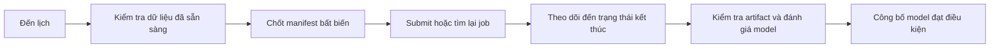

# Triển khai huấn luyện phân tán theo lịch Airflow: ba phương án

Ngày cập nhật: 2026-11-13. Phương án A được tích hợp vào `project_claude`; hướng dẫn chạy và giới hạn thực tế ở [training/README](../training/README.md). Kubernetes và Slurm bên dưới là thiết kế triển khai, chưa dựng cụm.

Training Control độc lập ở cổng 8001, hiện chạy Docker local qua Airflow. Phần quản lý máy và runner SSH đã được gỡ theo yêu cầu; [kiểm chứng SSH trước đây](ssh-training-plan.md) được giữ dưới dạng tài liệu lịch sử. Kubernetes và Slurm vẫn là thiết kế tham khảo.

Đọc kèm [nghiên cứu kiến trúc và nguồn nền](airflow-distributed-training-research.md). Tài liệu ghi lại ba hướng: một máy nhiều GPU, nhiều máy trên Kubernetes, nhiều máy trên Slurm. Theo yêu cầu, triển khai trước phương án một máy trong ứng dụng PDM hiện hữu, có giao diện theo dõi tại sensor.

## 1. Phạm vi và giả định

Ví dụ dùng Linux, GPU NVIDIA và PyTorch DDP. Đây là cấu hình minh họa, không phải yêu cầu phần cứng đã được xác nhận. Nếu model không vừa bộ nhớ một GPU, đánh giá FSDP/ZeRO thay cho DDP thuần; backend điều phối vẫn có thể giữ nguyên. [Nguồn: PyTorch FSDP](https://docs.pytorch.org/docs/stable/fsdp.html).

| Phương án | Ví dụ tài nguyên | Đơn vị Airflow quản lý | Thành phần cấp tài nguyên |
|---|---|---|---|
| A. Một máy nhiều GPU | 1 máy × 4 GPU = 4 rank | Một container train | Server GPU dành riêng và khóa tài nguyên trên host |
| B. Kubernetes nhiều máy | 2 training node × 4 GPU = 8 rank | Một Kubeflow `TrainJob` | Kubernetes và admission/scheduler được cấu hình |
| C. Slurm nhiều máy | 2 compute node × 4 GPU = 8 rank | Một Slurm job allocation | Slurm |

Một rank là một tiến trình train; ví dụ DDP ở đây dùng một tiến trình/GPU. Airflow chỉ gửi job, theo dõi và xử lý kết quả. `torchrun` khởi tạo nhóm tiến trình. [Nguồn: torchrun](https://docs.pytorch.org/docs/stable/elastic/run.html).

Các đoạn lệnh dưới đây là mẫu kiến trúc tổng quát; đường dẫn và cờ tham số phải thay theo backend. Bộ chạy thực tế của phương án A nằm trong `training/`, dùng DAG `single_node_rul_training` và launcher PowerShell được mô tả ở README.

## 2. Thiết kế chung cho cả ba phương án

### 2.1. Workflow



Đề xuất một task `run_training` giữ trách nhiệm submit và theo dõi cùng một job. Có thể tách submit/monitor, nhưng phải giữ mã job bền vững và không để khoảng giữa hai task làm mất giới hạn tài nguyên. Không tạo một Airflow task độc lập cho mỗi GPU của cùng một lần train đồng bộ.

### 2.2. Dữ liệu, mã job và artifact

Mỗi run chốt manifest chứa:

- Khoảng dữ liệu và URI/version/checksum của dataset đã sẵn sàng.
- Phiên bản code hoặc image digest, config, seed và cấu hình train.
- `run_key`, backend, số node/GPU và URI output riêng.
- Checkpoint cần resume, nếu có, cùng thông tin tương thích.

Đề xuất tạo `run_key` từ hash của `(dag_id, run_id, task_id, trial_id)`, chuẩn hóa thành tên hợp lệ trên backend. Retry cùng task dùng lại khóa; một lần restart có chủ đích dùng thêm `attempt_generation`, tách khỏi Airflow `try_number`. Lưu liên kết khóa → backend job ID vào registry bền vững với ràng buộc duy nhất. Không chỉ giữ liên kết trong biến của worker hay XCom có thể bị xóa khi retry.

Trước khi submit, khóa theo `run_key`, tìm job đã có và kiểm tra manifest khớp. Nếu mất phản hồi sau submit, reconcile trạng thái trước khi tạo lại. Check-then-create đơn thuần không bảo đảm exactly-once. Dataset/checkpoint/artifact dùng kho chia sẻ; XCom chỉ mang ID/URI nhỏ. Đây là thiết kế đề xuất dựa trên [Airflow best practices](https://airflow.apache.org/docs/apache-airflow/stable/best-practices.html).

Job chỉ thành công khi backend xác nhận hoàn tất, artifact đủ và đọc được. Bước đánh giá quyết định có công bố model hay không; train thành công không tự động đổi model đang phục vụ. Lưu kết quả đánh giá và công bố bằng thao tác có điều kiện để retry không ghi đè nhầm phiên bản.

### 2.3. Lịch và giới hạn tài nguyên

| Thiết lập đề xuất | Mục đích |
|---|---|
| Lịch, múi giờ và data window tường minh | Phân biệt giờ kích hoạt với khoảng dữ liệu train |
| `catchup=False` nếu không cần train lịch cũ | Tránh tự tạo backlog ngoài chủ đích |
| `max_active_runs=1` khi cần tuần tự | Giới hạn các run của cùng DAG |
| Pool riêng cho training | Giới hạn task/job từ các DAG cùng dùng pool |
| Hạn chờ tài nguyên, khởi động, train, theo dõi | Phân biệt thiếu GPU với lỗi training hoặc mất kết nối |

Chọn timetable theo data window; không suy ra ngày dữ liệu từ giờ hiện tại. Khi train dài hơn chu kỳ, chọn rõ xếp hàng mọi run hay chỉ giữ dữ liệu mới nhất. [Nguồn: Airflow timetables](https://airflow.apache.org/docs/apache-airflow/stable/authoring-and-scheduling/timetable.html), [giới hạn DAG run](https://airflow.apache.org/docs/apache-airflow/stable/faq.html).

Nếu dùng deferrable operator/sensor, chạy triggerer và bật tính deferred task trong pool khi pool đại diện job GPU còn hoạt động. Pool không cấp phát GPU; backend vẫn phải quản lý tài nguyên thật, kể cả workload ngoài Airflow. [Nguồn: Airflow pools](https://airflow.apache.org/docs/apache-airflow/stable/administration-and-deployment/pools.html), [deferral](https://airflow.apache.org/docs/apache-airflow/stable/authoring-and-scheduling/deferring.html).

### 2.4. Chương trình train cần đáp ứng

DDP cần gán GPU theo `LOCAL_RANK`, khởi tạo process group, chia dataset và đồng bộ gradient. Nếu dùng `DistributedSampler`, gọi `set_epoch()` phù hợp mỗi epoch. Đây là logic trong ứng dụng train, không nằm trong Airflow. [Nguồn: PyTorch DDP](https://docs.pytorch.org/docs/stable/generated/torch.nn.parallel.DistributedDataParallel.html), [DistributedSampler](https://docs.pytorch.org/docs/stable/data.html#torch.utils.data.distributed.DistributedSampler).

Yêu cầu triển khai: lưu checkpoint định kỳ gồm model, optimizer, scheduler, tiến độ và trạng thái ngẫu nhiên cần thiết; công bố checkpoint hoàn chỉnh bằng manifest. Với DDP có thể chỉ rank 0 ghi model dùng chung, nhưng trạng thái riêng từng rank cần được xử lý đúng; với sharding dùng cơ chế checkpoint của framework. Resume phải kiểm tra dataset/config/code và hỗ trợ topology đã chọn. Thiết kế ban đầu đặt runtime restart bằng 0 để dễ quan sát; chỉ bật retry sau khi kiểm chứng phục hồi.

## 3. Phương án A: một máy nhiều GPU

### 3.1. Kiến trúc và điều kiện

```text
Airflow → SSH/runner trên server GPU → Docker container → torchrun → 4 rank
                                      ↘ volume/kho chung: dữ liệu, checkpoint, artifact
```

Đề xuất dùng server dành riêng, một job chiếm toàn bộ GPU tại một thời điểm. Cần driver, Docker, NVIDIA Container Toolkit và image tương thích driver/CUDA/PyTorch. Kiểm tra `nvidia-smi` trên host và quyền truy cập GPU trong container theo [hướng dẫn NVIDIA](https://docs.nvidia.com/datacenter/cloud-native/container-toolkit/latest/install-guide.html).

Tạo vùng `/srv/training/manifests`, `/srv/training/runs` và quyền đọc/ghi cho người chạy container. Image đề xuất chứa `/app/train.py`; code/config được khóa phiên bản. Không cài thư viện train nặng vào tiến trình scheduler Airflow.

### 3.2. Tạo và khởi động container

Ví dụ Bash chạy trên server GPU, sau khi đã giữ lease độc quyền GPU và xác nhận chưa có container của cùng khóa. `TRAIN_IMAGE` phải là image đã build, ưu tiên digest; `JOB_KEY` là khóa đã chuẩn hóa và `MANIFEST` đã được đặt lên host.

```bash
: "${TRAIN_IMAGE:?Cần image train đã khóa phiên bản}"
: "${JOB_KEY:?Cần khóa job đã chuẩn hóa}"

docker create --name "train-${JOB_KEY}" \
  --gpus all --shm-size=8g \
  --mount type=bind,src=/srv/training,dst=/work \
  --entrypoint torchrun \
  "$TRAIN_IMAGE" \
  --standalone --nnodes=1 --nproc-per-node=4 --max-restarts=0 \
  /app/train.py \
  --manifest "/work/manifests/${JOB_KEY}.json" \
  --output "/work/runs/${JOB_KEY}"

docker start "train-${JOB_KEY}"
```

`docker create` tạo container chưa chạy; tên ổn định hỗ trợ tìm lại trước khi start. Không tự xóa container ngay khi xong, để lần retry còn đối chiếu trạng thái. `--gpus all` chỉ đưa GPU vào container, không phải cơ chế khóa độc quyền giữa các container. Runner phải giữ lease đến khi workload kết thúc hoặc đã hủy xong. [Nguồn: Docker create](https://docs.docker.com/reference/cli/docker/container/create/), [Docker GPU access](https://docs.docker.com/engine/containers/resource_constraints/#gpu), [torchrun](https://docs.pytorch.org/docs/stable/elastic/run.html).

Các giá trị 4 GPU và 8 GB shared memory là ví dụ; đo lại số DataLoader worker, CPU/RAM và shared memory cho workload thật.

### 3.3. Airflow và vòng đời job

Đề xuất kết nối `SSHOperator`/`SSHHook` tới GPU host qua Airflow Connection. Chỉ gửi lệnh runner ngắn; monitor theo chu kỳ, dùng sensor reschedule hoặc operator hỗ trợ deferral. Không để `SSHOperator` chờ nhiều giờ mà quên `cmd_timeout`; timeout lệnh SSH mặc định được tài liệu ghi là 10 giây. [Nguồn: SSHOperator](https://airflow.apache.org/docs/apache-airflow-providers-ssh/stable/_api/airflow/providers/ssh/operators/ssh/index.html).

Runner/adapter cần viết phải xử lý:

| Trạng thái container | Xử lý |
|---|---|
| Chưa có | Giữ lease → tạo → lưu registry → start |
| `created` | Xác nhận cấu hình và lease rồi start |
| `running` | Theo dõi container hiện có; không tạo mới |
| Đã kết thúc, exit code 0 | Kiểm tra artifact rồi trả kết quả |
| Đã kết thúc, lỗi | Giữ log/checkpoint; chỉ restart theo chính sách |
| Mất kết nối host | Trạng thái chưa rõ; reconcile, không kết luận chưa có job |

Khi Airflow worker chết, container có thể vẫn chạy: retry phải tìm lại bằng tên/ID. Hủy job phải dừng toàn container, xác nhận đã dừng rồi trả lease; không chỉ ngắt SSH. Giữ checkpoint trên volume, áp dụng thời hạn lưu log/container sau khi registry đã ghi kết quả.

### 3.4. Trình tự đưa vào sử dụng

1. Chuẩn bị driver, toolkit, image, thư mục và Connection.
2. Chạy smoke test một GPU, sau đó 4 GPU; xác nhận đúng 4 rank.
3. Viết runner/registry/lease và adapter Airflow; kiểm tra submit trùng, restart worker, cancel.
4. Kiểm chứng checkpoint/resume rồi mới bật retry và lịch thật.

## 4. Phương án B: nhiều máy trên Kubernetes

### 4.1. Kiến trúc và điều kiện

```text
Airflow → Kubernetes API → Kubeflow TrainJob → JobSet → 2 training pod × 4 GPU
                          ↘ admission/quota, runtime, DNS và network
```

Cụm cần GPU worker, driver/device plugin phù hợp, Kubeflow Trainer, JobSet và runtime Torch tương thích cùng phiên bản. Mỗi training pod cần đủ 4 GPU; nếu yêu cầu hai máy vật lý khác nhau, runtime phải cấu hình placement/anti-affinity theo hostname. `numNodes: 2` tự nó không bảo đảm hai máy vật lý. Dữ liệu/checkpoint dùng object storage hoặc shared volume đã kiểm chứng truy cập từ mọi pod. [Nguồn: Kubernetes GPU scheduling](https://kubernetes.io/docs/tasks/manage-gpus/scheduling-gpus/), [Trainer runtime](https://trainer.kubeflow.org/en/latest/operator-guides/runtime.html), [pod placement](https://kubernetes.io/docs/concepts/scheduling-eviction/assign-pod-node/).

Khóa bộ phiên bản Kubernetes, Trainer, JobSet, GPU plugin, runtime và Airflow provider trước khi viết DAG. Ví dụ dưới dùng Trainer v2 `TrainJob`, không dùng CRD `PyTorchJob` của Training Operator v1. Cài controller/runtime theo release đã chọn; không dùng nhánh `master` làm phiên bản production.

### 4.2. TrainJob tham khảo

Ví dụ cần image có `/app/train.py`, ứng dụng tự đọc manifest/output từ URI. Thay các chuỗi `REPLACE_*`; namespace `ml-training` và runtime `torch-distributed` phải tồn tại. Cấp quyền đọc kho dữ liệu qua cơ chế credentials của cụm, không nhúng secret vào YAML này.

```yaml
apiVersion: trainer.kubeflow.org/v1alpha1
kind: TrainJob
metadata:
  name: train-replace-run-key
  namespace: ml-training
spec:
  runtimeRef:
    apiGroup: trainer.kubeflow.org
    kind: ClusterTrainingRuntime
    name: torch-distributed
  trainer:
    image: REPLACE_WITH_IMAGE_AT_DIGEST
    numNodes: 2
    numProcPerNode: 4
    command: ["torchrun", "/app/train.py"]
    args:
      - "--manifest"
      - "s3://REPLACE_BUCKET/manifests/REPLACE_RUN_KEY.json"
      - "--output"
      - "s3://REPLACE_BUCKET/runs/REPLACE_RUN_KEY/"
    resourcesPerNode:
      requests:
        cpu: "16"
        memory: "64Gi"
        nvidia.com/gpu: "4"
      limits:
        cpu: "16"
        memory: "64Gi"
        nvidia.com/gpu: "4"
```

Runtime Torch cung cấp cấu hình topology cho `torchrun`; không dùng `--standalone` trên từng pod của cùng job nhiều node. Đối chiếu `numProcPerNode`, command và resource schema với CRD đã cài. CPU/RAM ở đây là ví dụ. [Nguồn: Trainer ML policy](https://trainer.kubeflow.org/en/latest/operator-guides/ml-policy.html), [TrainJob CRD](https://github.com/kubeflow/trainer/blob/master/manifests/base/crds/trainer.kubeflow.org_trainjobs.yaml), [ví dụ command trong lifecycle guide](https://trainer.kubeflow.org/en/latest/user-guides/trainjob-lifecycle.html).

Trước khi chạy, kiểm tra schema trên cụm thử:

```bash
kubectl explain trainjob.spec.trainer
kubectl get clustertrainingruntime torch-distributed -o yaml
kubectl create --dry-run=server -f trainjob.yaml
```

### 4.3. Submit, theo dõi và tài nguyên

Adapter Airflow dùng API của đúng CRD: GET theo namespace/name → CREATE khi chưa có → lưu UID → theo dõi conditions theo phiên bản đã khóa. Khi CREATE timeout hoặc trả conflict, GET lại và kiểm tra manifest/identity. Không sửa spec của job đang chạy bằng apply mỗi lần retry. Theo dõi UID để phát hiện tài nguyên cùng tên đã bị thay thế.

Đây là adapter cần viết, không phải lời gọi có sẵn trong repo. Không truyền TrainJob vào `KubernetesJobOperator`: operator đó quản lý `batch/v1 Job`. Nếu chỉ thử một node bằng Job operator, phải bật `wait_until_job_complete=True`; dùng deferrable cũng cần bật chờ. [Nguồn: Airflow Job operator](https://airflow.apache.org/docs/apache-airflow-providers-cncf-kubernetes/stable/_api/airflow/providers/cncf/kubernetes/operators/job/index.html).

Với cụm dùng chung, chọn admission/gang scheduling được Trainer hỗ trợ. Nếu chọn Kueue, cấu hình integration, queue, quota và readiness theo phiên bản cài; quota tổng không bảo đảm pod có placement phù hợp. Đặt hạn chờ đủ pod để tránh một phần rank giữ GPU mãi. Network phải cho phép rendezvous và lưu lượng collective giữa các pod; mở riêng cổng rendezvous chưa đủ cho mọi kết nối NCCL. [Nguồn: Kueue all-or-nothing](https://kueue.sigs.k8s.io/docs/concepts/all_or_nothing/), [Trainer scheduling](https://trainer.kubeflow.org/en/latest/operator-guides/job-scheduling/overview.html), [PyTorch distributed networking](https://docs.pytorch.org/docs/stable/distributed.html).

Quy định hủy toàn TrainJob và tài nguyên con, đợi giải phóng GPU rồi mới retry. Thu log theo rank/pod và giữ terminal status trước khi garbage collection. Không đánh dấu thành công chỉ vì API nhận TrainJob hoặc pod chuyển sang Running.

### 4.4. Trình tự đưa vào sử dụng

1. Cài và khóa phiên bản controller, runtime, GPU plugin; xác nhận GPU allocatable.
2. Kiểm tra storage, image pull, DNS, network và placement giữa hai GPU host.
3. Chạy collective smoke test 2 node, sau đó train nhỏ đủ 8 rank.
4. Viết adapter Airflow cho CRD, registry, monitor và cancel; cấp quyền đúng namespace.
5. Thử thiếu GPU, mất một pod/node, restart Airflow worker, checkpoint/resume rồi bật lịch.

## 5. Phương án C: nhiều máy trên Slurm

### 5.1. Kiến trúc và điều kiện

```text
Airflow → SSH tới submit host → sbatch → Slurm allocation
                                          → srun: 1 launcher/node
                                          → torchrun: 4 rank/node
```

Giả định cụm Slurm đã có controller/compute node, GPU GRES, partition/account hợp lệ và accounting đủ để truy vết job. Python environment hoặc container runtime được site hỗ trợ phải có trên mọi node. Dùng shared filesystem cho script, manifest và checkpoint; nếu dùng object storage, ứng dụng phải đọc/ghi URI và hoàn tất upload trước khi báo thành công. [Nguồn: Slurm GRES](https://slurm.schedmd.com/gres.html), [sbatch](https://slurm.schedmd.com/sbatch.html).

### 5.2. Batch script tham khảo

Lưu mẫu thành `train.sbatch` khi triển khai. Mẫu dành cho hai node vật lý độc quyền, mỗi node đúng 4 GPU; đường dẫn và CPU/RAM phải thay theo site. Tạo `/shared/training/logs` trước khi submit vì Slurm mở log trước khi chạy phần thân script. Ví dụ dùng shared venv thay vì giả định cụm có Docker.

```bash
#!/usr/bin/env bash
#SBATCH --job-name=ddp-train
#SBATCH --nodes=2
#SBATCH --ntasks=2
#SBATCH --ntasks-per-node=1
#SBATCH --gpus-per-node=4
#SBATCH --cpus-per-task=16
#SBATCH --mem=64G
#SBATCH --time=08:00:00
#SBATCH --exclusive
#SBATCH --no-requeue
#SBATCH --chdir=/shared/training
#SBATCH --output=/shared/training/logs/%x-%j.out

set -euo pipefail
: "${MANIFEST_PATH:?Cần manifest trên shared filesystem}"
: "${OUTPUT_PATH:?Cần output riêng cho run}"

mapfile -t TRAIN_HOSTS < <(scontrol show hostnames "$SLURM_JOB_NODELIST")
export MASTER_ADDR="${TRAIN_HOSTS[0]}"
export MASTER_PORT=29400
export OMP_NUM_THREADS=4

exec srun --nodes=2 --ntasks=2 --ntasks-per-node=1 \
  --gpus-per-node=4 --gpu-bind=none --kill-on-bad-exit=1 \
  /shared/training/venv/bin/torchrun \
  --nnodes=2 --nproc-per-node=4 --max-restarts=0 \
  --rdzv-backend=c10d --rdzv-id="$SLURM_JOB_ID" \
  --rdzv-endpoint="${MASTER_ADDR}:${MASTER_PORT}" \
  /shared/training/train.py \
  --manifest "$MANIFEST_PATH" --output "$OUTPUT_PATH"
```

Ở đây có **2 Slurm task → 2 torchrun launcher → 8 rank**. Không đổi thành 8 Slurm task rồi để mỗi task sinh thêm 4 rank. Host rendezvous phải phân giải và truy cập được từ mọi compute node; kiểm tra cổng 29400 không bị chiếm. Node độc quyền giúp tránh chồng job nhưng không thay thế kiểm tra cổng/dịch vụ. Nếu dùng shared node, cần cơ chế chọn/giữ cổng của site. [Nguồn: srun](https://slurm.schedmd.com/srun.html), [scontrol](https://slurm.schedmd.com/scontrol.html), [torchrun](https://docs.pytorch.org/docs/stable/elastic/run.html), [ví dụ Slurm của PyTorch](https://github.com/pytorch/examples/blob/main/distributed/ddp-tutorial-series/slurm/sbatch_run.sh).

`--no-requeue` và `--max-restarts=0` làm trách nhiệm retry rõ ràng trong mẫu đầu tiên. Nếu site dùng preemption/requeue, cần thiết kế lại resume và state mapping trước khi bật; không tự cộng cả retry Slurm, torchrun và Airflow.

### 5.3. Submit, theo dõi và hủy

Ví dụ Bash trên submit host; `SLURM_PARTITION`, `SLURM_ACCOUNT`, `JOB_KEY`, `MANIFEST_PATH` và `OUTPUT_PATH` do adapter chuẩn bị/kiểm tra, không ghép thẳng đầu vào tùy ý thành shell command:

```bash
export MANIFEST_PATH OUTPUT_PATH
sbatch --parsable \
  --partition="$SLURM_PARTITION" --account="$SLURM_ACCOUNT" \
  --job-name="train-${JOB_KEY}" \
  --export=ALL /shared/training/train.sbatch
```

Lưu `job_id` và cluster nếu kết quả có dạng `jobid;cluster`. Adapter Airflow submit qua SSH Connection rồi theo dõi riêng; submit thành công chỉ chứng minh Slurm đã nhận job. `--job-name` không phải ràng buộc duy nhất. Dùng registry/khóa và reconcile khi SSH mất phản hồi sau submit. [Nguồn: sbatch](https://slurm.schedmd.com/sbatch.html), [SSHOperator](https://airflow.apache.org/docs/apache-airflow-providers-ssh/stable/_api/airflow/providers/ssh/operators/ssh/index.html).

Các lệnh monitor/cancel dưới đây giả định một cluster. Với federation phải truyền đúng cluster theo cấu hình site:

```bash
squeue --noheader --jobs="$job_id" --format='%i|%T|%R'
sacct --allocations --noheader --parsable2 \
  --jobs="$job_id" --format=JobIDRaw,State%40,ExitCode
scancel "$job_id"
```

| Kết quả quan sát | Xử lý adapter |
|---|---|
| Pending/running/configuring/completing | Chờ có giới hạn, ghi reason khi pending |
| Không còn trong `squeue` | Tra `sacct`; không mặc định thành công |
| `COMPLETED`, exit code `0:0` | Kiểm tra artifact rồi mới cho bước đánh giá chạy |
| Failed/OOM/timeout/cancel/node failure | Ghi lỗi; quyết định resume/retry theo chính sách |
| Preempted/requeued | Đối chiếu chính sách site; không tạo job mới khi job đang được requeue |
| Accounting chưa có hoặc mất kết nối | Giữ trạng thái chưa rõ, chờ/reconcile có giới hạn |

Chuẩn hóa state/flags theo Slurm version; chỉ lấy allocation đúng ID, không nhầm `.batch`/`.extern`. `scancel` phải hủy toàn job allocation và monitor đến khi ngừng chiếm tài nguyên. [Nguồn: sacct](https://slurm.schedmd.com/sacct.html), [job states](https://slurm.schedmd.com/job_state_codes.html), [scancel](https://slurm.schedmd.com/scancel.html).

### 5.4. Trình tự đưa vào sử dụng

1. Xác nhận account/partition/GRES, shared storage, environment và accounting với quản trị cụm.
2. Chạy script thủ công trong partition thử; xác nhận đúng 2 launcher và 8 rank.
3. Viết submit/monitor/cancel adapter Airflow, lưu mapping run → job/cluster.
4. Thử pending vì thiếu GPU, OOM, node lỗi, timeout, cancel và accounting trễ.
5. Kiểm chứng checkpoint/resume và submit mất phản hồi rồi bật lịch thật.

## 6. Các hạng mục cần xây dựng sau khi chọn phương án

| Hạng mục | Chung/A | Kubernetes | Slurm |
|---|---|---|---|
| Ứng dụng train, manifest, checkpoint, artifact | Chung | Dùng chung logic ứng dụng | Dùng chung logic ứng dụng |
| Submit/attach | Runner container và lease host | API TrainJob, namespace/name/UID | SSH/sbatch, job ID/cluster |
| Monitor/cancel | Docker state và stop container | Conditions và cleanup tài nguyên con | squeue/sacct và scancel |
| Môi trường thực thi | Training image | Image và runtime đã khóa phiên bản | Venv hoặc container theo site |
| GPU admission | Lease toàn server | Scheduler/admission của cụm | Slurm allocation |

Triển khai phương án A trước theo yêu cầu người dùng. Giữ thiết kế Kubernetes và Slurm để mở rộng sau khi có nhu cầu và hạ tầng tương ứng.

## 7. Điều kiện nghiệm thu và thông tin còn thiếu

Đây là checklist chung cho mọi backend. Kết quả kiểm chứng riêng phương án A được ghi trong README và tài liệu migration; không suy ra Kubernetes/Slurm đã được kiểm chứng:

- Đúng số rank; dữ liệu được chia đúng; collective smoke test và job train nhỏ hoàn tất.
- Retry hoặc restart Airflow worker tìm lại job, không tạo thêm workload khi trạng thái chưa rõ.
- Khi thiếu GPU, workload chờ có giới hạn và không giữ tài nguyên vô hạn.
- Lỗi một rank/node dẫn đến phục hồi có kiểm soát hoặc thất bại rõ ràng.
- Checkpoint đã ghi hoàn chỉnh có thể resume; output dở dang không được công bố.
- Cancel/timeout dừng toàn workload và trả GPU; giữ được log, backend ID và lý do kết thúc.
- Hai run không trùng output/rendezvous; task deferred vẫn được tính đúng ngân sách tài nguyên.
- Đo tổng thời gian, GPU utilization, I/O và chi phí giao tiếp so với baseline một GPU.

Trước khi triển khai thật cần điền: framework/model và mục tiêu train; số/loại GPU và node; OS/driver/network; backend sẵn có; Airflow/provider version; nơi lưu dữ liệu/checkpoint; chu kỳ lịch và thời lượng train; chính sách backlog/retry/cancel; tiêu chí đánh giá và công bố model. Các ví dụ 1×4 và 2×4 ở trên không phải cấu hình đã được chấp thuận.
