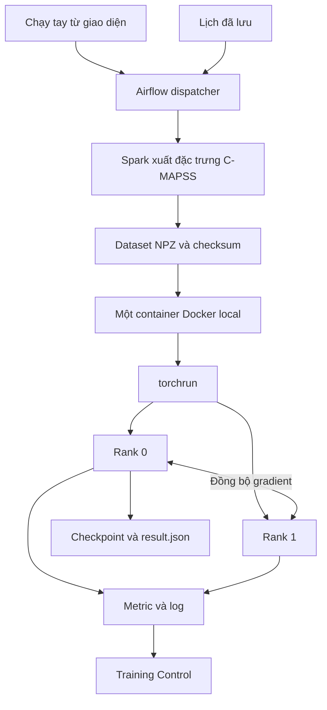

# Huấn luyện DDP trong dự án PDM

Ngày đối chiếu: **13/11/2026**. Phạm vi: mã `project_claude`, workload **PyTorch 2.6.0**, Docker và Airflow hiện hữu.

Tài liệu giải thích DDP, so sánh với train tập trung và hướng dẫn đọc bản triển khai thực tế. Hướng dẫn khởi động ngắn: [training/README](../training/README.md).

## 1. Trạng thái triển khai

Ứng dụng [Training Control](http://localhost:8001/) đã tách khỏi sensor. Mỗi lượt mới tạo **một container trên máy hiện tại**, bên trong chạy một hoặc nhiều process DDP. Phần quản lý máy/SSH đã gỡ; metadata của các lượt cũ được giữ như lịch sử.

Máy phát triển có 12 CPU logic và **một GTX 1650 Max-Q 4 GB**. Đã chạy CPU/Gloo hai rank và CUDA một rank. Chưa có benchmark một rank so với hai rank với điều kiện tương đương; chưa chứng minh tăng tốc hay hiệu năng nhiều GPU vật lý.

Pipeline Spark GBT cũ vẫn phục vụ dự đoán. Model PyTorch DDP là ứng viên riêng, chưa tự thay `models/current.json`.

## 2. Các khái niệm cần phân biệt

| Khái niệm | Ý nghĩa trong dự án |
|---|---|
| Process | Một tiến trình Python thực hiện train |
| Rank | Số thứ tự của process trong nhóm DDP: 0, 1, … |
| World size | Tổng số process tham gia cùng một lượt train |
| Local rank | Số thứ tự process trên node hiện tại |
| Node | Một môi trường máy tham gia job; không đồng nghĩa với một rank |
| Container | Môi trường chứa chương trình; có thể chứa nhiều process |
| Epoch | Một lượt duyệt dữ liệu theo sampler |
| Batch size | Trong giao diện hiện tại: số mẫu mỗi process lấy trong một bước đầy batch |

`torchrun` khởi động các process và cung cấp `RANK`, `LOCAL_RANK`, `WORLD_SIZE`. Các biến này mô tả nhóm worker; chương trình train vẫn phải chọn device/backend. Xem [source torchrun 2.6.0](https://github.com/pytorch/pytorch/blob/v2.6.0/torch/distributed/run.py#L208-L232).

Ví dụ: một máy chạy một container chứa hai process thì có hai rank. Điều đó không tạo thêm máy hoặc GPU vật lý.

## 3. DDP hoạt động thế nào?

Mỗi rank giữ một bản model và optimizer riêng. Với batch riêng, rank thực hiện forward và tính loss; DDP đồng bộ gradient trong quá trình backward. Sau đó mỗi rank gọi `optimizer.step()` để cập nhật model cục bộ. Xem [distributed basics 2.6](https://docs.pytorch.org/docs/2.6/distributed.html#basics).

Ví dụ đơn giản, hai rank bắt đầu từ cùng trọng số; loss lấy trung bình và hai batch có cùng kích thước:

```text
Rank 0: batch A → gradient g0
Rank 1: batch B → gradient g1

Gradient sau đồng bộ: g = (g0 + g1) / 2
Mỗi rank dùng gradient g để cập nhật bản model của mình.
```

Trong chế độ DDP thông thường, all-reduce được kích hoạt theo các bucket gradient ngay khi backward tạo đủ gradient. Không phải đợi toàn bộ `loss.backward()` kết thúc rồi mới bắt đầu trao đổi. Khi backward trả về, gradient đồng bộ đã sẵn sàng cho optimizer. Xem [DDP design note](https://docs.pytorch.org/docs/2.6/notes/ddp.html#internal-design); trang này mô tả thiết kế nền từ v1.4, đối chiếu thêm [source DDP v2.6.0](https://github.com/pytorch/pytorch/blob/v2.6.0/torch/nn/parallel/distributed.py).

DDP nhân bản model, không tự chia các layer để ghép bộ nhớ nhiều GPU. Đây là cách song song hóa theo dữ liệu; bản model của mỗi process vẫn phải vừa tài nguyên được cấp.

## 4. So với train tập trung một process

| Tiêu chí | Một process | Nhiều process DDP |
|---|---|---|
| Công việc mỗi epoch | Process duyệt tập train | Các rank xử lý các phần do sampler chọn |
| Model/optimizer | Một bản | Một bản cho mỗi rank |
| Gradient | Tính và dùng cục bộ | Đồng bộ giữa các rank trước bước optimizer |
| Chi phí bổ sung | Không có collective giữa rank | Thêm giao tiếp, đồng bộ và các bản sao |
| Khả năng tận dụng phần cứng | Tài nguyên của một process | Có thể tận dụng nhiều thiết bị/process được cấp |
| Chất lượng dự đoán | Phụ thuộc model, dữ liệu, cách học | Không tự tốt hơn chỉ vì có thêm rank |

### Batch toàn cục

Với batch đầy, cùng kích thước giữa rank và không gradient accumulation:

```text
global_batch = batch_per_rank × world_size
```

Do `DataLoader` của mỗi process tạo batch riêng và DDP không tự cắt input, batch 64 với hai rank tương ứng 128 lượt mẫu/bước đầy. Đây là suy ra từ cách kết hợp [DataLoader](https://docs.pytorch.org/docs/2.6/data.html#automatic-batching-default) và [DDP input handling](https://github.com/pytorch/pytorch/blob/v2.6.0/torch/nn/parallel/distributed.py#L295-L372). Batch cuối có thể nhỏ hơn.

Ví dụ so sánh cùng global batch:

| Cấu hình | Rank | Batch mỗi rank | Global batch đầy |
|---|---:|---:|---:|
| A: baseline một process | 1 | 128 | 128 |
| B: DDP hai process | 2 | 64 | 128 |

Trong chương trình hiện tại, A vẫn sử dụng DDP wrapper với world size 1 để giữ cùng đường code. Đây là baseline một process, không phải một bản đã loại bỏ toàn bộ chi phí khởi tạo DDP.

### Chia dữ liệu không đồng nghĩa mỗi mẫu luôn xuất hiện đúng một lần

Code dùng `DistributedSampler` với `drop_last=False` mặc định. Nếu số mẫu không chia hết cho world size, sampler bổ sung chỉ số để mọi rank có cùng số mẫu. Ví dụ 4.407 mẫu và hai rank tạo 2.204 lượt mẫu/rank, tổng 4.408 lượt: có một lượt lặp. Code gọi `sampler.set_epoch(epoch)` để thay đổi shuffle theo epoch. Xem [DistributedSampler](https://docs.pytorch.org/docs/2.6/data.html#torch.utils.data.distributed.DistributedSampler) và [source sampler 2.6.0](https://github.com/pytorch/pytorch/blob/v2.6.0/torch/utils/data/distributed.py#L99-L139).

Hiện mỗi process vẫn nạp toàn bộ mảng train vào RAM, rồi sampler quyết định chỉ số cần xử lý. Chia việc tính toán không có nghĩa bộ nhớ dataset đã được chia đều và loại bỏ bản sao.

## 5. Airflow, Spark, Docker và DDP phối hợp



Trách nhiệm từng phần trong mã hiện tại:

| Thành phần | Trách nhiệm |
|---|---|
| Training Control | Lưu cấu hình, yêu cầu chạy/hủy, hiển thị lịch sử và tiến độ |
| Airflow | Điều phối task, retry và gọi runner |
| Spark | Tạo cửa sổ, đặc trưng và nhãn để xuất dataset |
| Docker runner | Tạo/tìm lại container, đọc log, kiểm tra trạng thái và artifact |
| `torchrun` | Khởi động các process và nhóm worker |
| PyTorch DDP | Đồng bộ gradient giữa các process |

DAG `single_node_rul_training` kiểm tra mỗi phút. Cấu hình ứng dụng mới quyết định có tạo lượt train hay không: lịch tắt, mỗi 5 phút, mỗi giờ hoặc 02:00 giờ Việt Nam. Một DAG tick thành công không nhất thiết đã train model.

Đường DDP hiện đọc raw C-MAPSS và nhóm train/validation cố định; chưa tự dùng tập Parquet mới do bước `build_training_set` của pipeline GBT tạo ra. Spark worker cũng không phải các rank DDP.

Các nhận xét ở phần này được đối chiếu trực tiếp với [DAG](../spark/dags/single_node_rul_training.py), [prepare.py](../training/prepare.py), [exporter](../spark/src/jobs/export_torch_data.py) và [runner.py](../training/runner.py).

## 6. Dữ liệu, model và metric thực tế

Theo [train.py](../training/train.py) và exporter của dự án:

- Dùng nhóm train/validation trong `models/norm_stats/groups.json`; nhóm replay không tham gia hai tập này.
- Có 33 đầu vào: tuổi máy và mean/std của 16 sensor. Xuất tối đa 50.000 cửa sổ mỗi split theo thứ tự hash ổn định.
- `fraction=0.2` chọn một phần số máy của nhóm train; không có nghĩa mỗi rank đều dùng 20% tổng dữ liệu một cách độc lập.
- Chuẩn hóa đầu vào bằng mean/std tính trên train; dùng lại các giá trị đó cho validation.
- MLP: `33 → 64 → 32 → 2`, ReLU ở hai tầng ẩn, Adam với seed 42.
- Hai đầu ra: RUL chuẩn hóa theo 125 và logit sắp hỏng. Nhãn sắp hỏng là còn tối đa 60 chu kỳ, theo [labels.py](../spark/src/pdm/labels.py).

Loss đang dùng:

```text
loss = MSE(RUL dự đoán chuẩn hóa, RUL thật / 125)
       + 0.2 × BCEWithLogits(logit sắp hỏng, nhãn sắp hỏng)
```

| Metric trên UI | Được tính ở đâu? |
|---|---|
| Loss | Trung bình loss train, gộp theo số lượt mẫu của các rank |
| RUL RMSE | Validation; RUL dự đoán được đưa về chu kỳ và chặn trong [0, 125] |
| F1, accuracy | Validation cho nhãn sắp hỏng; ngưỡng logit 0 |
| Epoch/progress | Tiến độ workload báo về runner |
| `elapsed_seconds` | Từ sau khi workload khởi tạo dữ liệu/model, không gồm toàn bộ Spark/Docker/Airflow startup |

Validation được chia bằng `rank::world_size`; các rank cộng SSE, số mẫu, TP/FP/FN để tính metric chung. `dist.all_reduce(values)` trong đoạn đánh giá dùng để gộp **metric**; gradient train do DDP đồng bộ trong backward.

Rank 0 lưu checkpoint qua file tạm rồi đổi tên. File chứa trọng số model, Adam state, epoch, thống kê chuẩn hóa và fingerprint dataset. `result.json` chứa cấu hình/kết quả. Hiện chưa có cờ CLI hoặc luồng tự resume từ checkpoint.

## 7. Cách chạy và quan sát

Từ thư mục gốc repository, trên Windows có Docker Desktop:

```powershell
powershell -ExecutionPolicy Bypass -File .\training\Start-Training.ps1
```

Mở <http://localhost:8001/> và thực hiện:

1. Chờ Docker, image PyTorch và DAG sẵn sàng.
2. Chọn CPU/Gloo, số rank 2, epoch và batch size mong muốn; bấm lưu cấu hình.
3. Bấm **Chạy ngay qua Airflow**; quan sát cả rank 0 và rank 1, metric theo epoch và log.
4. Kiểm tra checkpoint và trạng thái hoàn thành. Dùng **Dừng lượt train** nếu cần hủy.

Runner tạo lệnh tương đương sau trong container, với đường dẫn output riêng cho run:

```bash
torchrun --standalone --nnodes=1 --nproc-per-node=2 --max-restarts=0 \
  /app/train.py --device cpu --epochs 12 --batch-size 64 \
  --learning-rate 0.003 --output /artifacts/runs/<run-hash> \
  --fingerprint <dataset-fingerprint>
```

Đây là lệnh minh họa cấu trúc runner, không phải lệnh chạy độc lập trên host: runner còn chép dataset vào `/data/training.npz` và gắn volume artifact. CPU dùng Gloo; CUDA dùng NCCL, chọn thiết bị theo local rank. Xem [hướng dẫn backend PyTorch](https://docs.pytorch.org/docs/2.6/distributed.html#which-backend-to-use).

Tắt lịch chỉ ngăn tạo lượt theo lịch tiếp theo; muốn dừng lượt đang chạy phải dùng nút dừng. Cấu hình mới không sửa snapshot của lượt đang thực thi.

## 8. So sánh tốc độ cho công bằng

Đây là **quy trình đề xuất**, chưa có kết quả benchmark:

1. Giữ cùng dataset/fingerprint, fraction, model, optimizer, learning rate, epoch và giới hạn CPU/RAM.
2. Chạy A: CPU một rank, batch 128. Đợi hoàn thành rồi chạy B: CPU hai rank, batch 64.
3. Chạy warm-up và lặp mỗi cấu hình nhiều lần; không chạy đồng thời với job nặng khác.
4. Đo riêng thời gian toàn pipeline và thời gian vòng train; so median cùng định nghĩa đo. Không dùng thời gian một run có cache để so với run phải xuất dataset mới.
5. So RMSE/F1 trên cùng validation để kiểm tra chất lượng cùng với tốc độ. Padding, thứ tự batch và phép tính số thực có thể khiến kết quả không trùng tuyệt đối.

```text
speedup = thời gian 1 rank / thời gian W rank
efficiency = speedup / W
```

Nhiều rank không tạo thêm tài nguyên vật lý. Container hiện bị giới hạn **2 CPU và 3 GB RAM**, mỗi process đặt một thread PyTorch; tăng rank vượt tài nguyên thực có thể tăng tranh chấp. DDP có thêm chi phí đồng bộ, nên demo MLP nhỏ này có thể không nhanh hơn một process. Chưa có dữ liệu đo để kết luận chiều hoặc mức thay đổi tốc độ.

Không dùng Spark GBT cũ làm baseline tốc độ cho MLP DDP: đó là hai thuật toán và đường thực thi khác nhau.

## 9. Bằng chứng và giới hạn

Lượt [run 9](http://localhost:8001/?run=9), đối chiếu từ API ngày 13/11/2026:

| Thuộc tính | Giá trị |
|---|---|
| Thiết bị / rank | CPU/Gloo, 2 rank trong một container |
| Epoch / batch mỗi rank | 12 / 64 |
| Fraction | 0.2 |
| Kết quả | `succeeded`; cả hai rank đạt epoch 12 |
| Loss cuối | 0.041981 |
| RUL RMSE validation | 20.776612 |
| F1 validation | 0.835021 |

Đây là bằng chứng thực thi và chất lượng của một run, **không phải bằng chứng tăng tốc DDP**. Nguồn kết quả: API `/api/training/gpu/runs/9`; bản kiểm chứng cục bộ: `.local/ssh-removal/verification.json`.

Các giới hạn hiện tại:

- Một run hoạt động cùng lúc trong Training Control; một container cho mỗi run mới.
- Chỉ có một GPU vật lý để thử CUDA một rank; API từ chối yêu cầu vượt số GPU phát hiện.
- Chưa triển khai nhiều container cho các run mới, nhiều máy, Kubernetes hoặc Slurm; SSH đã gỡ.
- Runner kiểm tra Docker exit, telemetry cuối mọi rank và artifact thực, không suy ra thành công chỉ từ một dòng log. Nạp lại model từ checkpoint là bước kiểm chứng riêng, không phải toàn bộ công việc của runner.
- Retry tìm lại container theo tên/label ổn định; không tự phục hồi việc học sang container mới sau lỗi.
- Chưa tự đưa ứng viên PyTorch vào inference Spark.

## 10. Bản đồ mã và nguồn đọc thêm

| File | Nội dung |
|---|---|
| [control/service.py](../training/control/service.py) | State SQLite, lịch, snapshot run, khóa một lượt chạy |
| [runner.py](../training/runner.py) | Docker lifecycle, retry/attach, hủy, telemetry và artifact |
| [train.py](../training/train.py) | DDP, sampler, optimizer, metric, checkpoint |
| [prepare.py](../training/prepare.py) | Cache và checksum dataset, gọi Spark export |
| [export_torch_data.py](../spark/src/jobs/export_torch_data.py) | Xuất đặc trưng train/validation sang NPZ |
| [single_node_rul_training.py](../spark/dags/single_node_rul_training.py) | DAG điều phối |
| [TrainingTab.tsx](../training/frontend/src/TrainingTab.tsx) | Giao diện cấu hình và theo dõi |

Đọc [DDP tutorial chính thức](https://docs.pytorch.org/tutorials/intermediate/ddp_tutorial.html) để có ví dụ tổng quát. Tài liệu API mới có thể khác PyTorch 2.6 của dự án; khi đối chiếu chi tiết, dùng các liên kết phiên bản 2.6 và source tag `v2.6.0` ở trên.
