# Kiến trúc và triển khai: Nền tảng bảo trì dự đoán cho IoT công nghiệp

Oct 16, 2026 · @DoctHoai

## 1. Tổng quan

Hệ thống nhận liên tục số đo cảm biến của hàng trăm động cơ, dự đoán mỗi động cơ còn chạy được bao nhiêu chu kỳ trước khi hỏng (RUL), và tự sinh lệnh bảo trì trước thời điểm đó. Mô hình được huấn luyện lại hằng ngày và chỉ thay mô hình cũ khi đo được là tốt hơn. Toàn bộ chạy trong 11 container Docker trên một máy, dựng bằng một lệnh `docker compose up -d --build` trong thư mục `v2/`.

### Yêu cầu của đề tài 9 và cách đáp ứng

| Yêu cầu trong đề | Hệ thống đáp ứng bằng |
| --- | --- |
| Kafka nhận dữ liệu cảm biến ≥ 500 events/giây | Bộ giả lập giữ N máy ảo (mặc định 500), mỗi máy phát k bản tin mỗi giây; chỉnh được tới khoảng 5.000 events/giây khi đang chạy |
| Spark Streaming làm sạch dữ liệu | Lọc giá trị ngoài miền hợp lệ, khử bản tin trùng, xử lý bản tin trễ và đảo thứ tự |
| Trích đặc trưng cửa sổ trượt (rolling mean, rolling std) | Cửa sổ 30 chu kỳ, bước 5 chu kỳ, giữ trạng thái theo từng máy |
| GBT hoặc Random Forest trên Spark MLlib ước lượng RUL | Hai mô hình Gradient-Boosted Trees: hồi quy RUL và phân lớp "sắp hỏng", chung 33 đặc trưng |
| Lên lịch bảo trì tự động | Lệnh bảo trì sinh khi xác suất sắp hỏng ≥ 0,5, kèm chu kỳ đề xuất bảo trì; mỗi máy tối đa một lệnh |
| Airflow điều phối huấn luyện lại và kiểm định định kỳ | DAG `retrain_rul` chạy hằng ngày: tạo tập huấn luyện → huấn luyện → kiểm định → cổng kiểm định → thay hoặc giữ mô hình |

### Ngoài phạm vi

- Thiết bị cảm biến thật: luồng IoT được giả lập từ dữ liệu NASA C-MAPSS.
- Cụm nhiều máy vật lý, HDFS, bảo mật, chịu lỗi của broker. Cụm Spark là nhiều container trên cùng một máy.
- Tối ưu lịch bảo trì có ràng buộc (số đội thợ, chi phí dừng máy).

### Thuật ngữ

| Thuật ngữ | Nghĩa |
| --- | --- |
| Máy ảo | Một động cơ giả lập, mã `vm-000123`, sinh từ vòng đời một hoặc hai động cơ C-MAPSS |
| Bản tin | Một lần đo của một máy ở một chu kỳ: 3 thiết lập vận hành và 21 cảm biến |
| Chu kỳ | Đơn vị thời gian của C-MAPSS (một chuyến bay). Bộ giả lập phát k chu kỳ mỗi giây |
| RUL | Remaining Useful Life: số chu kỳ còn lại trước khi hỏng |
| Sắp hỏng | RUL ≤ 60 chu kỳ |
| Điều kiện vận hành | Một trong 6 tổ hợp độ cao, tốc độ, ga; suy ra bằng cách làm tròn 3 cột thiết lập |
| Lỗi chèn | Lỗi cố ý đưa vào luồng để thử phần làm sạch: giá trị sai, mất, trễ, trùng |
| Mô hình đang dùng | Phiên bản mô hình mà `models/current.json` trỏ tới |
| Cổng kiểm định | Quy tắc quyết định mô hình mới có thay mô hình đang dùng hay không |

## 2. Kiến trúc tổng quan

Hệ thống có hai đường dữ liệu. **Đường nóng** biến bản tin cảm biến thành dự đoán và lệnh bảo trì trong vài giây. **Đường lạnh** chạy hằng ngày, học lại từ những máy đã hỏng và đưa mô hình tốt hơn quay về đường nóng.

```mermaid
flowchart TB
  subgraph HOT["ĐƯỜNG NÓNG · kết quả sau vài giây"]
    S["Bộ giả lập cảm biến :8000<br/>FastAPI + React, có Lỗi chèn"] -->|"N × k bản tin/giây"| K["Kafka 4.2.2 KRaft :9094<br/>sensor.raw, machine.failed"]
    K --> J["Job luồng Spark :4040<br/>làm sạch → chuẩn hóa → cửa sổ 30 chu kỳ → 2 GBT"]
    J -->|"dự đoán, lệnh bảo trì"| P["Postgres 17 :5432"]
    P -->|SQL| G["Grafana 13.2.3 :3000"]
  end
  subgraph COLD["ĐƯỜNG LẠNH · hằng ngày"]
    L["Kho Parquet /data/lake<br/>readings/, failures/"] -->|"gán nhãn bằng sự kiện hỏng"| A["Airflow 3.3.2 :8088<br/>DAG retrain_rul"]
    A -->|"chỉ khi qua cổng"| M["Thư mục mô hình /models<br/>phiên bản GBT, current.json"]
  end
  J -->|lưu| L
  M -.->|"nạp mô hình mới mỗi lô"| J
```



Mũi tên nét đứt là vòng khép kín: job luồng đọc `current.json` mỗi lô và tự nạp phiên bản mới, không phải khởi động lại.

### Luồng dữ liệu đầu-cuối

1. **Đo.** Bộ giả lập phát bản tin của mỗi máy ảo vào topic `sensor.raw`.
2. **Dự đoán.** Job luồng làm sạch, chuẩn hóa, tính đặc trưng trên cửa sổ 30 chu kỳ rồi chấm bằng hai mô hình GBT, mỗi 5 chu kỳ một lần cho mỗi máy.
3. **Hành động.** Máy có xác suất sắp hỏng ≥ 0,5 được ghi một lệnh bảo trì vào Postgres; Grafana hiện ngay.
4. **Sự thật.** Khi máy ảo chạy hết vòng đời, bộ giả lập phát sự kiện vào `machine.failed`. Lúc này mới biết RUL thật của mọi bản tin cũ của máy đó.
5. **Lưu.** Job luồng ghi bản tin sạch và sự kiện hỏng vào kho Parquet.
6. **Học lại.** Airflow ghép kho để gắn nhãn, huấn luyện ứng viên, so với mô hình đang dùng trên nhóm kiểm định, và chỉ đổi `current.json` khi ứng viên tốt hơn.

### Công nghệ của từng khối

| Khối | Công nghệ | Lý do chọn |
| --- | --- | --- |
| Nguồn dữ liệu | FastAPI, numpy, confluent-kafka, React | Chỉnh tải và cách sinh khi đang chạy; có đáp án để đối chiếu |
| Thu nạp | Apache Kafka 4.2.2 | Log giữ lại được nên job hỏng thì đọc lại; khóa theo mã máy giữ đúng thứ tự |
| Xử lý luồng | Spark 4.1.3 Structured Streaming | Trạng thái theo từng máy, checkpoint, chạy trên cụm |
| Lưu trữ | Parquet | Lưu theo cột: huấn luyện chỉ đọc 16 trong 21 cảm biến |
| Học máy | Spark MLlib, Gradient-Boosted Trees | Huấn luyện phân tán; pipeline lưu và nạp lại được |
| Điều phối | Apache Airflow 3.3.2 | Chạy huấn luyện lại theo lịch, thấy rõ bước nào hỏng |
| Phục vụ | PostgreSQL 17, Grafana 13.2.3 | SQL đủ cho dashboard; Grafana đọc trực tiếp |
| Đóng gói | Docker Compose | Một lệnh dựng toàn bộ, cùng phiên bản trên mọi máy |

## 3. Triển khai chung

Mọi dịch vụ khai báo trong một file `v2/docker-compose.yml`. Một lệnh dựng 11 container; năm trong số đó dùng chung image `pdm-v2` nên driver, executor và Airflow luôn cùng bản Python và Spark.

```
cd v2
docker compose up -d --build
```

### Các container

| Container | Image | Cổng trên máy | Vai trò | Chạy |
| --- | --- | --- | --- | --- |
| `kafka` | `apache/kafka:4.2.2` | 9094 | Broker và controller (KRaft), một nút | Thường trực |
| `kafka-ui` | `kafbat/kafka-ui:v1.1.0` | 8085 | Xem topic, partition, bản tin, lag | Thường trực |
| `sensor` | build từ `sensor/` | 8000 | Bộ giả lập cảm biến (FastAPI + React) | Thường trực |
| `spark-master` | `pdm-v2` | 8080 | Điều phối cụm Spark standalone | Thường trực |
| `spark-worker-1` | `pdm-v2` | 8081 | Worker 2 core, 2 GB | Thường trực |
| `spark-worker-2` | `pdm-v2` | 8082 | Worker 2 core, 2 GB | Thường trực |
| `init` | `pdm-v2` | — | Chia nhóm máy, bảng chuẩn hóa, mô hình đầu | Một lần rồi thoát |
| `spark` | `pdm-v2` | 4040 | Driver của job luồng | Thường trực |
| `airflow` | `pdm-v2` | 8088, 4041 | Airflow standalone và driver của job huấn luyện | Thường trực |
| `postgres` | `postgres:17` | 5432 | Database `pdm` (kết quả) và `airflow` (metadata) | Thường trực |
| `grafana` | `grafana/grafana:13.2.3` | 3000 | Dashboard vận hành | Thường trực |

### Thứ tự khởi động

Thứ tự do `depends_on` và healthcheck quyết định:

1. `kafka` và `postgres` khởi động trước. Kafka kiểm bằng `kafka-broker-api-versions.sh`, Postgres bằng `pg_isready`, mỗi 5 giây.
2. `init` chạy một lần. Nếu đã có `models/current.json` thì thoát ngay. Nếu chưa, nó kiểm đủ 4 file `train_FD00x.txt`, chạy `prepare_data.py` (chia 709 máy thành 70% huấn luyện gốc, 10% kiểm định, 20% phát lại; tính bảng chuẩn hóa và miền hợp lệ) rồi `train.py 0.2` (phiên bản đầu học 20% nhóm gốc, khoảng 2 phút).
3. `sensor`, `spark`, `airflow` chỉ chạy khi `init` thoát thành công. Bộ giả lập cần `groups.json` để biết máy nào được phát lại; job luồng cần mô hình để chấm.
4. `kafka-ui` chờ Kafka khỏe; `grafana` chờ Postgres khỏe.

### Thư mục và volume

| Trên máy | Trong container | Dùng bởi | Nội dung |
| --- | --- | --- | --- |
| `v2/spark` | `/app` | Spark, init, Airflow | Mã nguồn, DAG, kiểm thử |
| `v2/data` | `/data` | Spark, init, Airflow | `raw/` dữ liệu gốc C-MAPSS, `lake/` kho Parquet |
| `v2/models` | `/models` | Spark, init, Airflow; sensor chỉ đọc | Thư mục mô hình |
| volume `checkpoints` | `/checkpoints` | driver `spark` và hai worker | Checkpoint của bốn truy vấn luồng |
| volume `kafka` | `/var/lib/kafka/data` | kafka | Log của topic |
| volume `postgres` | `/var/lib/postgresql/data` | postgres | Dữ liệu của hai database |
| volume `sensor-state` | `/state` | sensor | Kịch bản đã lưu, số mã máy kế tiếp |
| volume `airflow-home` | `/opt/airflow-home` | airflow | Cấu hình và log của Airflow |

Mã, dữ liệu và mô hình được gắn **cùng đường dẫn** vào mọi container Spark và Airflow. Nhờ đó executor trên worker đọc được đúng file mà driver chỉ định, thay cho HDFS. Checkpoint nằm trên volume Docker thay vì thư mục gắn từ Windows, vì ghi file nhỏ mỗi vài giây lên thư mục gắn từ Windows rất chậm.

### Tài nguyên và bảo mật

- Docker cần ít nhất 10 GB RAM: `%UserProfile%\.wslconfig` đặt `[wsl2]` `memory=12GB`.
- Mọi cổng chỉ mở trên `127.0.0.1`, vì Spark UI, Kafka và Kafka UI không có đăng nhập. Muốn mở cho mạng LAN thì bỏ tiền tố `127.0.0.1:` trong file compose.
- Mật khẩu Postgres và Grafana lấy từ biến môi trường `POSTGRES_PASSWORD`, `GRAFANA_PASSWORD`; giá trị mặc định (`pdm`, `admin`) chỉ dành cho máy phát triển.

## 4. Bộ giả lập cảm biến

Bộ giả lập biến vòng đời của 709 động cơ NASA C-MAPSS thành luồng bản tin liên tục vào Kafka, N × k bản tin mỗi giây (tối đa khoảng 5.000). Mọi tham số chỉnh được ngay khi đang chạy, không phải khởi động lại.

### Công nghệ

| Thành phần | Công nghệ | Vai trò |
| --- | --- | --- |
| API | FastAPI 0.115, uvicorn 0.34 | REST để điều khiển, WebSocket để đẩy số liệu sống |
| Bộ máy sinh (`engine/`) | Python thuần + numpy 2.2 | Sinh vòng đời máy ảo, đội máy, Lỗi chèn; không đụng mạng hay đồng hồ nên kiểm thử độc lập được |
| Gửi Kafka | confluent-kafka 2.6, orjson 3.10 | Gửi không chờ xác nhận từng nhịp; đếm số đã xác nhận qua callback |
| Giao diện | React 18, TypeScript, Vite 6, Recharts 2.15 | Bảng điều khiển, theo dõi, xem trước máy sinh thử |

### Cách sinh dữ liệu

Mỗi máy ảo được sinh sẵn trọn vòng đời lúc ra đời, bằng một trong bốn phương pháp theo tỷ lệ trộn chỉnh được. Mọi biến đổi làm trên giá trị đã chuẩn hóa z = (x − μ) / σ theo điều kiện vận hành, rồi đổi ngược về số đo thật.

| Phương pháp | Vòng đời mới |
| --- | --- |
| `gauss` | Một máy nguồn giữ nguyên, chỉ cộng nhiễu |
| `warp` | Một máy nguồn co giãn thời gian theo hệ số f trong \[0,7; 1,5\] |
| `blend` | Trộn hai máy nguồn cùng tập con theo trọng số w ngẫu nhiên |
| `parametric` | Khớp mỗi cảm biến với đường mũ z = a + b·e^(c·τ), bốc tham số mới từ phân bố đã khớp |

Khi một máy phát xong chu kỳ cuối, bộ giả lập phát một sự kiện hỏng và thay bằng máy mới, nên số máy sống luôn bằng N. Mã máy không bao giờ lặp lại, kể cả sau khi khởi động lại. Bộ giả lập chỉ lấy nguồn từ nhóm phát lại (20% máy, đọc từ `groups.json`), nên mô hình không "thấy trước" dữ liệu luồng.

### Lỗi chèn

Mỗi bản tin bốc đúng một kết cục theo tỷ lệ cấu hình:

- `bad_value`: một cảm biến thành −9999 hoặc gấp 10 lần.
- `drop`: không gửi.
- `late`: giữ lại 1 đến `late_max_s` giây rồi gửi, `event_time` giữ nguyên.
- `duplicate`: gửi bản gốc rồi thêm một bản sao.

### Hợp đồng dữ liệu

Topic `sensor.raw` (khóa `machine_id`), mỗi bản tin một JSON:

```json
{"machine_id": "vm-000123", "cycle": 87, "event_time": "2026-10-15T09:30:12.400Z",
 "setting1": 20.0004, "setting2": 0.7002, "setting3": 100.0,
 "s1": 491.19, "...": "...", "s21": 14.8301,
 "truth": {"rul": 153, "method": "warp", "fault": null}}
```

Trường `truth` chứa đáp án (RUL thật, cách sinh, loại lỗi) để đánh giá. Job xử lý của Spark đọc bằng lược đồ cố định không có trường này, nên mô hình không thể dùng đáp án.

Topic `machine.failed` (khóa `machine_id`), phát khi máy hỏng:

```json
{"machine_id": "vm-000123", "failed_at": "2026-10-15T09:32:45.000Z", "last_cycle": 240,
 "method": "blend", "base": ["FD002-017", "FD002-104"], "params": {"weight": 0.37}}
```

### API chính

| Đường dẫn | Việc |
| --- | --- |
| `GET`, `PATCH /api/config` | Đọc, sửa cấu hình (N, k, nhiễu, tập con, tỷ lệ phương pháp, Lỗi chèn, hạt giống); sai trả 422 kèm lý do |
| `POST /api/start`, `/stop`, `/reset` | Chạy, dừng, tạo lại đội máy từ hạt giống |
| `GET /api/machines`, `/api/machines/{id}` | Danh sách máy ảo; trọn vòng đời của một máy |
| `POST /api/preview` | Sinh thử một máy cạnh máy nguồn, không đụng đội máy đang chạy |
| `/api/scenarios/...` | Lưu, nạp, xóa kịch bản có tên |
| `WS /ws/stats` | Mỗi giây: events đã gửi và đã xác nhận, máy sống, máy đã hỏng, Lỗi chèn, lỗi Kafka |
| `WS /ws/machines/{id}` | Đẩy từng bản tin của một máy ngay khi phát |

### Triển khai

- Dockerfile hai tầng: `node:22.12.0-alpine` chạy `npm ci` và `npm run build` cho giao diện; `python:3.12-slim-bookworm` cài backend và chép bản build tĩnh vào `static/`. Lệnh chạy: `uvicorn --factory app.main:build --port 8000`.
- Cổng 8000. Khởi động ở trạng thái dừng: mở giao diện rồi bấm Chạy.
- Gắn chỉ đọc `data/raw/cmapss` và `models` (để đọc `norm_stats/groups.json`); volume `sensor-state` giữ kịch bản và số mã máy kế tiếp.
- Chờ `kafka` khỏe và `init` xong. Tự tạo hai topic lúc khởi động nếu chưa có. Kafka gặp sự cố thì bộ giả lập không chết: lỗi được đếm và hiện trên giao diện.

## 5. Kafka

Kafka là hàng đợi bền giữa bộ giả lập và Spark. Nó giữ lại log, nên khi job Spark dừng rồi chạy lại, job đọc tiếp từ offset lưu trong checkpoint mà không mất bản tin.

### Công nghệ

- **Apache Kafka 4.2.2, chế độ KRaft**: một nút vừa là broker vừa là controller, không cần ZooKeeper.
- **Kafka UI (kafbat 1.1.0)**: giao diện web xem topic, partition, nội dung bản tin và độ trễ đọc (lag) của Spark.

### Topic

| Topic | Partition | Khóa | Nội dung | Người đọc |
| --- | --- | --- | --- | --- |
| `sensor.raw` | 3 | `machine_id` | Bản tin cảm biến | Truy vấn chấm điểm, truy vấn lưu kho |
| `machine.failed` | 1 | `machine_id` | Sự kiện máy hỏng kèm nguồn gốc | Truy vấn sự kiện hỏng, truy vấn kho sự kiện hỏng |

Khóa theo `machine_id` đưa mọi bản tin của một máy vào cùng một partition, nên chúng đến Spark theo đúng thứ tự phát. Bộ giả lập tự tạo hai topic lúc khởi động, không dựa vào việc broker tự tạo.

### Triển khai

| Cấu hình | Giá trị | Vì sao |
| --- | --- | --- |
| Listener `PLAINTEXT` | `kafka:9092` | Cho các container trong mạng Docker |
| Listener `EXTERNAL` | `localhost:9094` | Cho client chạy trực tiếp trên máy |
| Listener `CONTROLLER` | `:9093` | Giao tiếp nội bộ của KRaft |
| Hệ số nhân bản | 1 | Chỉ có một nút |
| Log | volume `kafka` | Giữ bản tin qua các lần khởi động lại |
| Healthcheck | `kafka-broker-api-versions.sh`, mỗi 5 giây, tối đa 30 lần | Dịch vụ khác chờ broker khỏe mới khởi động |

Kafka UI chạy ở container `kafka-ui`, cổng 8085, nối tới `kafka:9092`.

## 6. Cụm Spark

Cụm Spark standalone gồm 1 master và 2 worker, tổng 4 core và 4 GB cho executor. Job luồng giữ 2 core, job huấn luyện do Airflow gửi lên dùng 2 core còn lại, nên hai loại job chạy song song mà không tranh nhau.

### Image `pdm-v2`

Một image cho mọi container Spark và Airflow (`v2/spark/docker/Dockerfile`):

| Lớp | Nội dung | Vì sao |
| --- | --- | --- |
| Nền | `python:3.12-slim-bookworm` | Python của driver và executor phải cùng bản |
| Java | `openjdk-17-jre-headless`, `procps` | Spark 4 cần Java 17; script khởi động của Spark gọi `ps` |
| Spark | `pyspark==4.1.3` | Structured Streaming và MLlib |
| Thư viện | `pandas==2.2.3`, `pyarrow==18.1.0`, numpy | Hàm cửa sổ theo từng máy (`applyInPandas`, `applyInPandasWithState`) |
| Jar | `spark-sql-kafka-0-10_2.13:4.1.3`, `commons-pool2`, `postgresql:42.7.4` | Chép sẵn vào thư mục jars của Spark lúc build, nên lúc chạy không tải gì |
| Airflow | `apache-airflow[postgres]==3.3.2` trong venv riêng `/opt/airflow` | Bộ ràng buộc phiên bản của Airflow ghim pandas, pyarrow khác bản Spark dùng |

Biến môi trường `PYTHONPATH=/app/src` để mã trong `src/pdm` import được từ mọi job.

### Các nút của cụm

| Container | Lệnh | Tài nguyên | Giao diện |
| --- | --- | --- | --- |
| `spark-master` | `spark-class org.apache.spark.deploy.master.Master --port 7077` | — | 8080 |
| `spark-worker-1` | `spark-class ...Worker spark://spark-master:7077 --cores 2 --memory 2g` | 2 core, 2 GB | 8081 |
| `spark-worker-2` | như trên | 2 core, 2 GB | 8082 |
| `spark` (driver job luồng) | `python src/jobs/stream.py` | `spark.cores.max=2`, mỗi executor 1 core | 4040 |
| `airflow` (driver job huấn luyện) | `spark-submit --master spark://spark-master:7077 --conf spark.cores.max=2` | 2 core còn lại | 4041 |

### Điểm triển khai đáng chú ý

- `SPARK_PUBLIC_DNS=localhost` ở master, worker và driver, để link giữa các trang Spark UI mở được từ trình duyệt trên máy.
- `/app`, `/data`, `/models` gắn cùng đường dẫn ở driver và worker. Volume `checkpoints` gắn vào driver `spark` và hai worker.
- Job luồng chạy ở chế độ client: driver nằm trong container `spark`, executor nằm trên hai worker.
- `spark.sql.shuffle.partitions` bằng số core của job luồng (2). Giá trị này khóa số kho trạng thái ở lần chạy đầu; đổi nó phải xóa checkpoint.

## 7. Job luồng

Job luồng là một ứng dụng Spark Structured Streaming (`src/jobs/stream.py`) chạy bốn truy vấn cùng lúc. Truy vấn chấm điểm biến bản tin thô thành dự đoán RUL cho mỗi máy mỗi 5 chu kỳ; ba truy vấn còn lại lưu dữ liệu cho huấn luyện lại và cho dashboard.

### Bốn truy vấn

| Truy vấn | Đọc | Ghi | Nhịp |
| --- | --- | --- | --- |
| `cham_diem` | `sensor.raw` | Bảng `predictions`, `maintenance_orders` (JDBC) | 5 giây |
| `kho_ban_tin` | `sensor.raw` | `/data/lake/readings/`, Parquet phân vùng theo ngày | 60 giây |
| `su_kien_hong` | `machine.failed` | Bảng `failures` | 2 giây |
| `kho_su_kien_hong` | `machine.failed` | `/data/lake/failures/`, Parquet | 60 giây |

Mỗi truy vấn có thư mục checkpoint riêng trong `/checkpoints`. Nhịp 60 giây cho hai truy vấn ghi kho để tránh sinh hàng nghìn file Parquet nhỏ. Nhịp 2 giây cho sự kiện hỏng vì dashboard loại máy đã hỏng khỏi danh sách; nhịp dài làm các ô số lệch nhau.

### Các bước của truy vấn chấm điểm

1. **Đọc và phân tích.** Phân tích JSON bằng lược đồ cố định không có `truth`. Bản tin thiếu `machine_id`, `cycle` hoặc `event_time` bị loại.
2. **Làm sạch.** Số đo nằm ngoài miền hợp lệ \[min − 10% khoảng, max + 10% khoảng\] của nhóm huấn luyện gốc thành rỗng. Cách này bắt được cả −9999 lẫn giá trị gấp 10 lần.
3. **Chuẩn hóa.** Suy điều kiện vận hành từ 3 cột thiết lập, ghép bảng thống kê kiểu broadcast, tính z = (x − μ) / σ cho 16 cảm biến mang thông tin. Không chuẩn hóa thì chênh lệch giữa các điều kiện lớn hơn tín hiệu xuống cấp hàng chục lần.
4. **Cửa sổ theo trạng thái.** `groupBy(machine_id).applyInPandasWithState` giữ cho mỗi máy các bản tin của 35 chu kỳ gần nhất. Cửa sổ kết thúc ở chu kỳ e (e chia hết cho 5) được phát khi đã thấy chu kỳ e + 5, gồm trung bình và độ lệch chuẩn của 16 cảm biến trên 30 chu kỳ e − 29 … e, cộng tuổi máy: 33 đặc trưng. Cửa sổ có dưới 20 bản tin bị bỏ.
5. **Chấm điểm** (trong `foreachBatch`). Đọc `current.json`; phiên bản khác lần trước thì nạp hai mô hình mới. Áp mô hình hồi quy RUL và mô hình phân lớp sắp hỏng, ghi `predictions`.
6. **Lệnh bảo trì.** Máy có xác suất sắp hỏng ≥ 0,5 được ghi vào `maintenance_orders` với `ON CONFLICT (machine_id) DO NOTHING`, nên mỗi máy tối đa một lệnh.

Chu kỳ đề xuất bảo trì tính theo công thức (khoảng an toàn 20 chu kỳ, không nhỏ hơn tuổi hiện tại):

```latex
\text{suggested\_cycle} = \max\left(\text{age},\ \operatorname{round}(\text{age} + \widehat{RUL} - 20)\right)
```

### Xử lý bản tin trùng, trễ, đảo thứ tự

| Tình huống | Phía chấm điểm (trong trạng thái) | Phía kho |
| --- | --- | --- |
| Trùng `(machine_id, cycle)` | Giữ bản đến trước | `dropDuplicatesWithinWatermark` với watermark 10 giây |
| Trễ hoặc đảo thứ tự | Nhận nếu còn cửa sổ tương lai cần nó; trễ hơn thì bỏ. Cửa sổ đã phát không phát lại | Ghi theo `event_time` gốc |
| Máy im lặng 120 giây | Xóa trạng thái (timeout theo thời gian xử lý) | — |

### Vì sao cửa sổ tính theo chu kỳ, không theo giây

Bộ giả lập đổi được tốc độ k ngay khi đang chạy. Cửa sổ 30 giây sẽ chứa 30 chu kỳ khi k = 1 nhưng 150 chu kỳ khi k = 5, làm đặc trưng lúc chạy khác lúc huấn luyện. Cửa sổ theo chu kỳ luôn là 30 chu kỳ gần nhất. Hàm pandas tính cửa sổ là **một hàm dùng chung** cho cả huấn luyện (`applyInPandas`) lẫn luồng (`applyInPandasWithState`), nên hai phía không lệch nhau.

Hệ quả: 5 đến 9 chu kỳ cuối đời của mỗi máy không được chấm, vì cửa sổ chờ thấy chu kỳ e + 5 mới phát.

## 8. Kho Parquet và Thư mục mô hình

Hai thư mục này nối đường nóng với đường lạnh: job luồng ghi vào kho, Airflow đọc kho để huấn luyện rồi ghi phiên bản mới vào thư mục mô hình, job luồng lại đọc thư mục mô hình mỗi lô. Cả hai là thư mục trên máy (`v2/data`, `v2/models`) gắn vào mọi container Spark và Airflow; cụm một máy nên dùng thư mục chung thay cho HDFS.

### Kho Parquet `/data/lake`

| Thư mục | Ai ghi | Nội dung |
| --- | --- | --- |
| `readings/` | Truy vấn `kho_ban_tin`, mỗi 60 giây | Bản tin đã làm sạch và khử trùng, phân vùng theo `date` |
| `failures/` | Truy vấn `kho_su_kien_hong`, mỗi 60 giây | Sự kiện máy hỏng, có `last_cycle` |
| `training_sets/<run_id>/` | Bước `build_training_set` của DAG | Tập đặc trưng và nhãn của từng lần huấn luyện lại |

Kho là nơi duy nhất gắn được nhãn cho dữ liệu mới. Trước khi máy hỏng, không ai biết RUL thật; khi có sự kiện hỏng, mỗi bản tin cũ của máy đó có RUL thật = `last_cycle` − `cycle`.

Parquet lưu theo cột, nên bước huấn luyện chỉ đọc 16 trong 21 cảm biến cần dùng thay vì cả bản tin. File sink của Spark ghi Parquet đúng một lần nhờ checkpoint.

### Thư mục mô hình `/models`

| Đường dẫn | Ai ghi | Nội dung |
| --- | --- | --- |
| `norm_stats/groups.json` | `init` | Chia 709 máy: 70% huấn luyện gốc, 10% kiểm định, 20% phát lại; hạt giống cố định |
| `norm_stats/stats.json` | `init` | μ và σ của 16 cảm biến trong từng điều kiện vận hành (6 × 16), miền hợp lệ từng cột |
| `v<thời điểm>/rul/`, `failing/` | `init`, bước `train` | Hai `PipelineModel` của Spark MLlib |
| `v<thời điểm>/validation.json` | Bước `validate` | RMSE và F1 của ứng viên và của mô hình đang dùng |
| `current.json` | `init`, bước `promote` | Con trỏ tới mô hình đang dùng, ví dụ `{"version": "v20261015T000000"}` |

Phiên bản và `current.json` được ghi ra file tạm rồi đổi tên. Đổi tên là thao tác nguyên tử, nên job luồng không bao giờ đọc phải file viết dở. Phiên bản bị cổng từ chối vẫn nằm trên đĩa để tra cứu.

## 9. Mô hình và huấn luyện lại bằng Airflow

Hai mô hình Gradient-Boosted Trees của Spark MLlib dùng chung 33 đặc trưng. Airflow huấn luyện lại chúng hằng ngày trên nhóm gốc cộng các máy ảo đã hỏng, và chỉ thay mô hình đang dùng khi ứng viên qua Cổng kiểm định.

### Hai mô hình

|  | GBT hồi quy (`rul`) | GBT phân lớp (`failing`) |
| --- | --- | --- |
| Câu hỏi | Còn bao nhiêu chu kỳ? | Có hỏng trong 60 chu kỳ tới? |
| Nhãn | RUL thật, chặn trên ở 125 | RUL thật ≤ 60 |
| Dùng để | Tính chu kỳ đề xuất bảo trì | Quyết định có ra lệnh bảo trì (xác suất ≥ 0,5) |
| Đo bằng | RMSE | Precision, recall, F1 |

Tham số chung: `maxIter=50`, `maxDepth=5`, `stepSize=0.1`, `seed=42`. Mỗi mô hình là một `PipelineModel` lưu và nạp lại được nguyên khối. RUL bị chặn ở 125 vì khi máy còn khỏe, cảm biến chưa cho thấy gì, không nên bắt mô hình phân biệt RUL 200 với RUL 300.

**Kết quả đo trên tập test chính thức C-MAPSS** (707 máy, cửa sổ cuối mỗi máy; phiên bản `vfull-base` học trên cả nhóm gốc):

| Tập | Số máy | RMSE (RUL thật chặn 125) | RMSE (không chặn) | Precision | Recall |
| --- | --- | --- | --- | --- | --- |
| Gộp | 707 | 17,8 | 26,6 | 0,88 | 0,86 |
| FD001 | 100 | 18,6 | 19,8 | 0,89 | 0,87 |
| FD002 | 259 | 16,2 | 27,7 | 0,85 | 0,87 |
| FD003 | 100 | 17,7 | 19,0 | 0,94 | 0,71 |
| FD004 | 248 | 19,1 | 30,1 | 0,89 | 0,90 |

Số liệu lấy từ `models/vfull-base/test_metrics.json`.

### DAG `retrain_rul`

1. **`build_training_set`**: ghép `lake/readings` với `lake/failures`, tính RUL thật, lấy tối đa `max_failed` (mặc định 500) máy hỏng gần nhất, tính đặc trưng bằng hàm cửa sổ chung, gộp với nhóm gốc, ghi `lake/training_sets/<phiên bản>/`. Không có máy nào của nhóm kiểm định.
2. **`train`**: huấn luyện hai mô hình trên tập đó, ghi `models/<phiên bản>/`.
3. **`validate`**: đo ứng viên và mô hình đang dùng trên cùng nhóm kiểm định (10%), ghi `validation.json` và một dòng vào bảng `model_validation`.
4. **`gate`** (rẽ nhánh): đọc `validation.json`. Nhận khi RMSE của ứng viên **thấp hơn** và F1 **không thấp hơn** mô hình đang dùng.
5. **`promote`** khi nhận: ghi `current.json` mới bằng file tạm rồi đổi tên. Job luồng thấy ở lô kế tiếp và nạp mô hình mới, không khởi động lại. Hoặc **`keep_current`** khi từ chối: không đổi gì.

Tên phiên bản lấy từ thời điểm chạy (`v%Y%m%dT%H%M%S`). Ba bước nặng là `BashOperator` gọi `spark-submit` lên cụm; `gate` và `promote` là task Python nhẹ chạy ngay trong Airflow.

### Triển khai Airflow

| Cấu hình | Giá trị |
| --- | --- |
| Chế độ | `airflow standalone` (scheduler, API server, DAG processor trong một container) |
| Phiên bản | Airflow 3.3.2, venv riêng `/opt/airflow`, nằm cuối `PATH` để `spark-submit` vẫn dùng Python hệ thống có PySpark |
| DAG | `/app/dags` (gắn từ `v2/spark/dags`) |
| Metadata | Database `airflow` trong Postgres |
| Lịch | `@daily`, `catchup=False`, `max_active_runs=1` (hai lần huấn luyện không tranh 2 core) |
| Tham số khi chạy tay | `max_failed`; `fraction` < 1 để cố ý học ít, thử nhánh bị từ chối |
| Đăng nhập | Tắt (`SIMPLE_AUTH_MANAGER_ALL_ADMINS`), vì cổng chỉ mở trên localhost |
| Cổng | 8088 (giao diện Airflow), 4041 (Spark UI của job huấn luyện khi đang chạy) |

## 10. Postgres và Grafana

Postgres giữ kết quả chấm điểm dưới dạng bảng SQL; Grafana đọc thẳng bằng SQL, không cần lớp API ở giữa. Người vận hành mở một dashboard là biết bao nhiêu máy cần kiểm tra gấp và máy nào.

### Bảng trong database `pdm`

| Bảng | Ai ghi | Cột chính | Khóa, chỉ mục |
| --- | --- | --- | --- |
| `predictions` | Truy vấn chấm điểm | `machine_id`, `window_end`, `window_end_cycle`, `rul_pred`, `failing_prob`, `model_version`, `written_at` | Chỉ mục `(window_end)`, `(machine_id, window_end)`; cho phép dòng trùng (ghi ít nhất một lần) |
| `maintenance_orders` | Truy vấn chấm điểm | `machine_id`, `created_at`, `cycle`, `rul_pred`, `failing_prob`, `suggested_cycle`, `model_version` | Khóa chính `machine_id`: mỗi máy một lệnh |
| `failures` | Truy vấn sự kiện hỏng | `machine_id`, `failed_at`, `last_cycle`, `method`, `base` | Khóa chính `machine_id` |
| `model_validation` | Bước `validate` của DAG | `candidate`, `candidate_rmse`, `candidate_f1`, `current`, `current_rmse`, `current_f1`, `accepted` | — |

`window_end` là `event_time` lớn nhất trong cửa sổ, nên `written_at − window_end` là độ trễ đầu-cuối từ lúc bản tin được phát tới lúc dự đoán nằm trong Postgres. `suggested_cycle` tính bằng chu kỳ, không bằng giờ, vì số chu kỳ mỗi giây đổi được.

### Dashboard "Bảo trì dự đoán"

Làm mới mỗi 5 giây, mặc định xem 15 phút gần nhất. Mỗi máy được xếp mức theo dự đoán mới nhất: **Gấp** khi RUL dự đoán ≤ `$urgent` (mặc định 30), **Trung bình** khi ≤ `$medium` (mặc định 60), **Bình thường** còn lại. Biến `machine` chọn nhiều máy; mặc định là 5 máy RUL thấp nhất.

| Ô | Loại | Trả lời câu hỏi |
| --- | --- | --- |
| Tổng thiết bị; Gấp / Trung bình / Bình thường | 4 ô số (đỏ, cam, xanh) | Bao nhiêu máy cần kiểm tra ngay? |
| RUL dự đoán theo thời gian của các máy đã chọn | Biểu đồ đường, dải nền đỏ và cam theo ngưỡng | Máy này xuống cấp nhanh cỡ nào? |
| Số thiết bị theo mức theo thời gian | Biểu đồ xếp chồng | Đội máy đang khỏe lên hay xấu đi? |
| Lệnh bảo trì đang mở; đã hỏng trong khoảng đang xem | 2 ô số | Còn bao nhiêu việc cần làm? |
| Thiết bị cần kiểm tra: mã, mức, RUL, xác suất, chu kỳ đề xuất, phiên bản | Bảng, gấp nhất lên đầu | Kiểm tra máy nào trước? |
| Lệnh bảo trì có kịp không | Ô số + histogram số chu kỳ từ lúc ra lệnh tới lúc hỏng | Lệnh có ra trước khi máy hỏng? |
| Sai số RUL theo phương pháp sinh | Biểu đồ cột (RMSE trên máy đã hỏng) | Dữ liệu sinh kiểu nào khó dự đoán hơn? |
| Dự đoán mỗi giây, độ trễ p50 và p95 | Biểu đồ đường | Hệ thống có theo kịp tải? |
| Lịch sử Cổng kiểm định | Bảng | Mô hình đổi khi nào, vì sao? |

### Triển khai

- **Postgres 17**: cổng 5432, dữ liệu trên volume `postgres`. Script `spark/docker/postgres/01-schema.sql` gắn vào `docker-entrypoint-initdb.d`, chạy lần đầu: tạo bốn bảng và database `airflow`. Healthcheck `pg_isready` mỗi 5 giây.
- **Grafana 13.2.3**: cổng 3000, tài khoản `admin` / `$GRAFANA_PASSWORD`. Nguồn dữ liệu và dashboard nằm trong repo (`spark/docker/grafana/provisioning`, `dashboards/pdm.json`), nạp bằng provisioning; xóa volume rồi dựng lại vẫn có đủ dashboard.

## 11. Vận hành

Dựng hệ thống mất một lệnh; mọi thành phần đều có giao diện web để quan sát mà không phải vào trong container.

### Dựng từ đầu

1. Cài Docker, cấp ít nhất 10 GB RAM (`.wslconfig`: `memory=12GB`).
2. Chép dữ liệu C-MAPSS (`train_FD001.txt` … `train_FD004.txt`, `test_*`, `RUL_*`) vào `v2/data/raw/cmapss/`.
3. Trong `v2/`, chạy `docker compose up -d --build`. Lần đầu `init` mất khoảng 2 phút.
4. Mở bộ giả lập ở `http://localhost:8000`, bấm **Chạy**.
5. Mở Grafana ở `http://localhost:3000/d/pdm` để xem dự đoán và lệnh bảo trì xuất hiện.

### Giao diện

| Địa chỉ | Là gì | Xem gì |
| --- | --- | --- |
| `localhost:8000` | Bộ giả lập | Chỉnh N, k, cách sinh, Lỗi chèn; số bản tin đã gửi và đã xác nhận |
| `localhost:8085` | Kafka UI | Topic, partition, nội dung bản tin, lag của Spark |
| `localhost:8080` | Spark master | Hai worker, ứng dụng đang chạy, core đang dùng |
| `localhost:8081`, `:8082` | Spark worker | Executor của từng worker |
| `localhost:4040/StreamingQuery/` | Spark UI của job luồng | Tốc độ nhận từ Kafka, tốc độ xử lý, thời gian mỗi lô của từng truy vấn |
| `localhost:8088` | Airflow | DAG `retrain_rul`, chạy tay, log từng bước |
| `localhost:4041` | Spark UI của job huấn luyện | Chỉ có khi job đang chạy |
| `localhost:3000/d/pdm` | Grafana | Dashboard "Bảo trì dự đoán" |
| `localhost:5432` | Postgres | Database `pdm`, người dùng `pdm` |
| `localhost:9094` | Kafka | Cho client chạy trên máy |

### Kịch bản demo

1. Bật bộ giả lập với N = 500, k = 1: Kafka UI thấy bản tin vào `sensor.raw`.
2. Tab Structured Streaming ở cổng 4040: tốc độ nhận và xử lý của bốn truy vấn.
3. Grafana: số máy theo mức, đường RUL giảm dần, lệnh bảo trì xuất hiện trước khi máy hỏng.
4. Tăng k lên 10 (5.000 events/giây) để thử tải; bật Lỗi chèn 5% để thử phần làm sạch.
5. Airflow: chạy tay DAG với `fraction = 1` (được nhận, cột phiên bản trên Grafana đổi mà không khởi động lại job), rồi với `fraction` nhỏ (bị từ chối, `current.json` giữ nguyên).

### Kiểm tra và kiểm thử

- **Mỗi máy có dự đoán mỗi 5 chu kỳ**: truy vấn SQL trong `v2/README.md` đếm số máy, số cửa sổ không chia hết cho 5, số khoảng cách khác 5, và độ trễ p50 trong 90 giây gần nhất.
- **RAM từng container**: `docker stats --no-stream`.
- **Kiểm thử phần Spark** (pytest trong image `pdm-v2`): `docker run --rm -v "${PWD}/spark:/app" pdm-v2 pytest -q tests`. Kiểm hàm cửa sổ (kết quả luồng giống hệt chế độ tĩnh dù bản tin đảo thứ tự, trùng, chia lô bất kỳ), việc bỏ `truth`, công thức lệnh bảo trì, tập huấn luyện lại, làm sạch, cổng kiểm định.
- **Kiểm thử bộ giả lập**: pytest trong `sensor/backend` (bốn phương pháp sinh, đội máy, Lỗi chèn, tái lập bằng hạt giống, API với sink giả không cần Kafka).

## 12. Đánh đổi và giới hạn

Mỗi lựa chọn dưới đây có cái giá; nhóm chấp nhận nó vì lý do ghi ở cột cuối.

| Lựa chọn | Được | Mất | Vì sao chấp nhận |
| --- | --- | --- | --- |
| Gần Lambda (huấn luyện đọc kho Parquet), không phải Kappa (phát lại Kafka) | Huấn luyện đọc theo cột, nhanh; không cần giữ Kafka lâu | Hai đường xử lý riêng | Hai đường dùng chung một hàm tính đặc trưng |
| Cửa sổ chờ chu kỳ e + 5 mới phát | Bản tin trễ, đảo thứ tự vẫn được tính đúng | Dự đoán ra chậm vài giây; 5–9 chu kỳ cuối đời không được chấm | Lệnh bảo trì cần ra trước hỏng hàng chục chu kỳ, không cần vài chu kỳ cuối |
| Ghi Postgres ít nhất một lần | Đơn giản, nhanh | Dự đoán có thể trùng sau khi khởi động lại | Lệnh bảo trì không trùng nhờ khóa chính; đường tới Parquet là đúng một lần |
| Cụm Spark trên một máy | Vừa laptop, dựng bằng một lệnh | Không chịu lỗi phần cứng; không có HDFS | Mã viết bằng DataFrame API và cụm standalone thật, chuyển lên nhiều máy không phải sửa mã |
| Kafka một nút, nhân bản 1 | Ít tài nguyên | Mất nút là dừng thu nạp | Ngoài phạm vi đề tài; bộ giả lập chịu được Kafka mất tạm thời |
| Không đăng nhập cho Spark UI, Kafka UI, Airflow | Dễ demo | Ai vào được cổng là điều khiển được | Mọi cổng chỉ mở trên `127.0.0.1` |

### Giới hạn cần nói rõ khi báo cáo

- Dữ liệu sinh bằng `warp`, `blend`, `parametric` là dữ liệu tổng hợp. RMSE "trên dữ liệu thật" chỉ đo bằng tập test chính thức của C-MAPSS (Mục 9).
- C-MAPSS có nhiệt độ, áp suất, tốc độ quay nhưng không có cảm biến rung.
- Các số đo hiệu năng (thông lượng, độ trễ, RAM, thời gian huấn luyện với 1 và 2 worker) đang được đo ở lát 5, chưa có trong tài liệu này.
